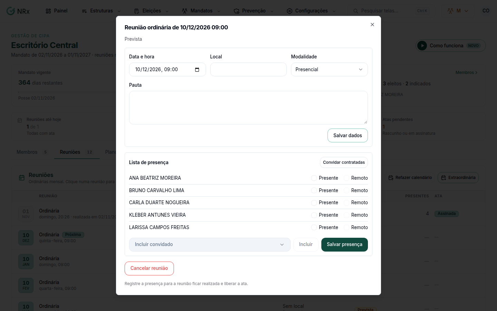

# Conduzir as reuniões da CIPA

**Para que serve:** agendar as reuniões do mandato, registrar a presença e criar a ata.


**Quem pode fazer:** Supervisor, Gestor ou Administrador, com a permissão de gerenciar reuniões, presença e atas. Refazer o calendário exige a permissão de gerenciar o mandato (Gestor e Administrador).


## Antes de começar

* Abra o [mandato](acompanhar-mandato.md).

## Passo a passo



### Veja o calendário

Na aba **Reuniões**, veja as reuniões previstas. Se o calendário estiver errado, use **Refazer calendário de reuniões**. Para uma reunião fora do calendário, agende uma **Reunião extraordinária** com o **Motivo** e clique em **Agendar**. Aparece "Reunião extraordinária agendada e membros avisados.".

<figure><figcaption>
Reunião
</figcaption></figure>



### Ajuste os dados

Abra a reunião. Ajuste **Data e hora**, **Local**, **Modalidade** e **Pauta**. Clique em **Salvar dados**.



### Registre a presença

Na **Lista de presença**, marque **Presente** ou **Remoto**. Para convidados, use **Incluir convidado** (ou **Convidar contratadas**). Clique em **Salvar presença**. Aparece "Presença registrada.".



### Crie a ata

Clique em **Criar ata**. Veja [Assinar uma ata](../atas/assinar-ata.md). Para registrar uma ação, use **Nova ação da reunião**: ela cria um plano de ação ligado ao mandato e à reunião. Veja [Acompanhar um plano de ação](../planos-acao/acompanhar-plano.md).



## Dúvidas comuns

A reunião não vai acontecer.

Clique em **Cancelar reunião**. Aparece "Reunião cancelada.".

Para onde vão as ações da reunião?

Cada uma vira um plano de ação ligado ao mandato e à reunião, na aba **Plano de ação** do mandato. Criar exige a permissão de criar plano de ação da CIPA.

