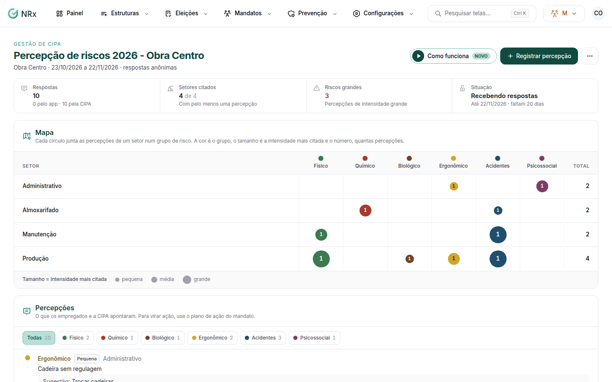

# Abrir um levantamento do mapa de risco

**Para que serve:** perguntar aos trabalhadores quais riscos eles percebem em cada setor. O mapa junta as respostas por setor e grupo de risco.


**Quem pode fazer:** Supervisor, Gestor ou Administrador, com a permissão de abrir levantamentos de percepção de riscos. Para só ver o mapa: a permissão de ver mandatos.


## Antes de começar

* Um levantamento é por unidade e por período.

## Passo a passo



### Abra o levantamento

Clique em **Prevenção › Mapa de risco** e depois em **Novo levantamento**. Escolha a unidade, dê um **Título** e informe o **Início** e o **Fim**. Deixe **Respostas anônimas** ligado (recomendado: as pessoas falam mais). Clique em **Abrir levantamento**. Aparece "Levantamento aberto. Os trabalhadores já podem responder.".

<figure><figcaption>
Mapa de risco
</figcaption></figure>



### Acompanhe as respostas

As respostas do app aparecem assim que chegam. Para registrar o que a CIPA viu numa inspeção, clique em **Registrar percepção**.



### Encerre

No fim, clique em **Encerrar levantamento** e confirme. Para virar ação, use o plano de ação do mandato.



## Dúvidas comuns

Como ler o mapa?

Cada círculo junta as percepções de um setor num grupo de risco. A cor é o grupo; o tamanho é a intensidade.

Anônimo mesmo?

Sim. Com **Respostas anônimas**, nada liga a resposta à pessoa, nem quem participou. Desligado, a CIPA vê o nome de quem respondeu.

