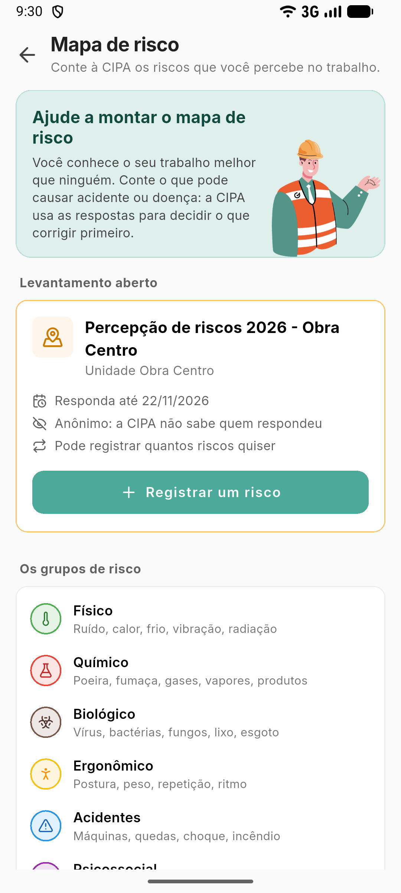

# Responder o mapa de risco pelo aplicativo

**Para que serve:** contar à CIPA o que pode causar acidente ou doença no seu trabalho. A CIPA usa as respostas para decidir o que corrigir primeiro.


**Quem pode fazer:** o colaborador da unidade, no **aplicativo GNRx Colaborador**, enquanto o levantamento está aberto.


## Antes de começar

* Você recebe um aviso quando a CIPA abre um levantamento.

## Passo a passo



### Abra o mapa de risco

No aplicativo, abra a aba **CIPA** e toque em **Mapa de risco**. Toque em **Registrar um risco**.

<figure><figcaption>
Mapa de risco no app
</figcaption></figure>



### Conte o risco

Escolha **Onde?** (o setor, ou **Não sei / vários setores**), **Qual o tipo de risco?**, **Qual a intensidade?** e escreva **O que você percebe?** (ex.: a bancada é baixa e fico curvado o dia todo). Se quiser, dê uma **Sugestão**.



### Envie

Envie. Você pode registrar quantos riscos quiser.



## Deu errado?

| Mensagem na tela | O que fazer |
| --- | --- |
| "Escolha o tipo de risco." / "Escolha a intensidade." | Escolha antes de enviar. |
| "Não foi possível enviar. Verifique sua conexão e tente de novo." | Confira a internet. |
| "Este levantamento já foi encerrado." | Aguarde o próximo levantamento. |

## Dúvidas comuns

A CIPA sabe que fui eu?

Depende do levantamento. Anônimo: ninguém fica sabendo quem enviou, nem a CIPA. Identificado: a CIPA vê o seu nome e pode conversar com você.

Quais são os tipos de risco?

Físico (ruído, calor, vibração), químico (poeira, gases), biológico (vírus, bactérias), ergonômico (postura, peso, repetição), de acidente (máquinas, quedas, choque) e psicossocial (pressão, metas, assédio).

