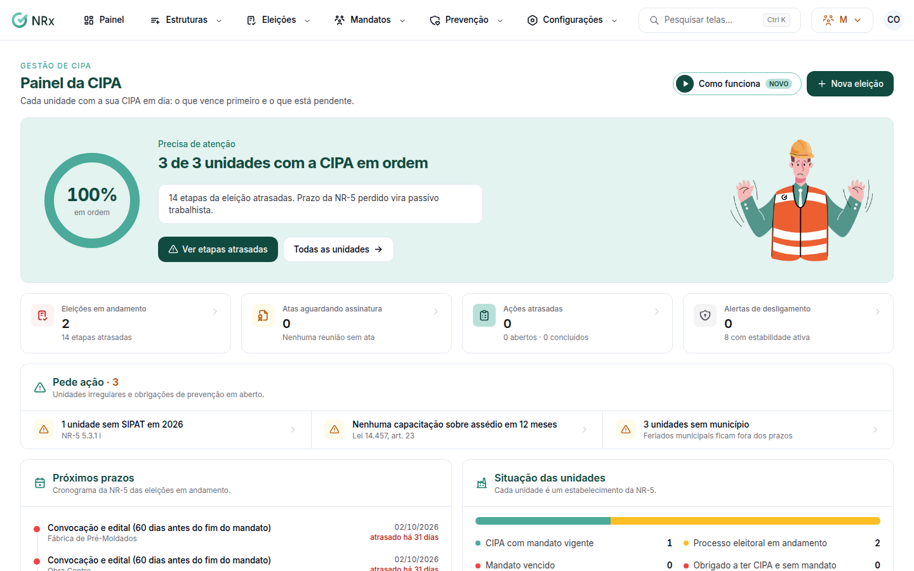

# Ver o painel da CIPA

**Para que serve:** ver, numa tela, a situação da CIPA de cada unidade, os próximos prazos das eleições e as pendências.


**Quem pode fazer:** quem abre o módulo Gestão de CIPA.


## Antes de começar

* A CIPA é por unidade: cadastre as unidades e configure o CNAE de cada uma.

## Passo a passo



### Abra o painel

Clique em **Painel**. Veja a **Situação das unidades** (**Precisa de atenção**, **Falta registrar**, **Em andamento** ou **Tudo em dia**) e os **Próximos prazos**.

<figure><figcaption>
Painel da CIPA
</figcaption></figure>



### Trate as pendências

Use **Ver etapas atrasadas**, **Resolver alertas** ou **Nova eleição**. O painel também avisa quando falta capacitação sobre assédio em 12 meses, regras de conduta publicadas ou e-mail para as denúncias.



## Dúvidas comuns

Apareceu "Tudo em dia".

CIPAs regulares, reuniões com ata e nenhum alerta aberto. Bom trabalho!

Apareceu "Nenhuma unidade cadastrada".

Cadastre as unidades e configure o CNAE de cada uma.

