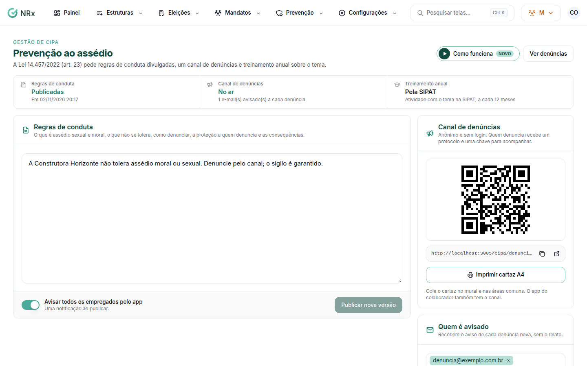

# Publicar as regras de conduta

**Para que serve:** publicar as regras de conduta sobre assédio e deixar o canal de denúncias pronto (Lei 14.457/2022, art. 23).


**Quem pode fazer:** Gestor ou Administrador, com a permissão de publicar as regras de conduta. Para alterar os e-mails do canal: só quem pode receber e apurar as denúncias.


## Antes de começar

* A lei pede regras de conduta divulgadas, um canal de denúncias e treinamento anual sobre o tema.

## Passo a passo



### Escreva as regras

Clique em **Prevenção › Prevenção ao assédio**. Em **Regras de conduta**, escreva o que é assédio sexual e moral, o que não se tolera, como denunciar, a proteção a quem denuncia e as consequências.

<figure><figcaption>
Prevenção ao assédio
</figcaption></figure>



### Publique

Se quiser, ligue **Avisar todos os empregados pelo app**. Publique. Aparece "Regras publicadas e empregados avisados pelo app." ou "Regras publicadas.".



### Configure o canal

Em **Canal de denúncias**, informe os e-mails que recebem o aviso de denúncia nova e clique em **Salvar e-mails**. Divulgue o link ou use **Imprimir cartaz A4**.



## Dúvidas comuns

E o treinamento anual?

É uma atividade com o tema na SIPAT, a cada 12 meses. Use **Ir para a SIPAT**.

Apareceu "Ninguém recebe aviso de denúncia nova".

Nenhum e-mail foi cadastrado no canal. Informe os e-mails e salve.

