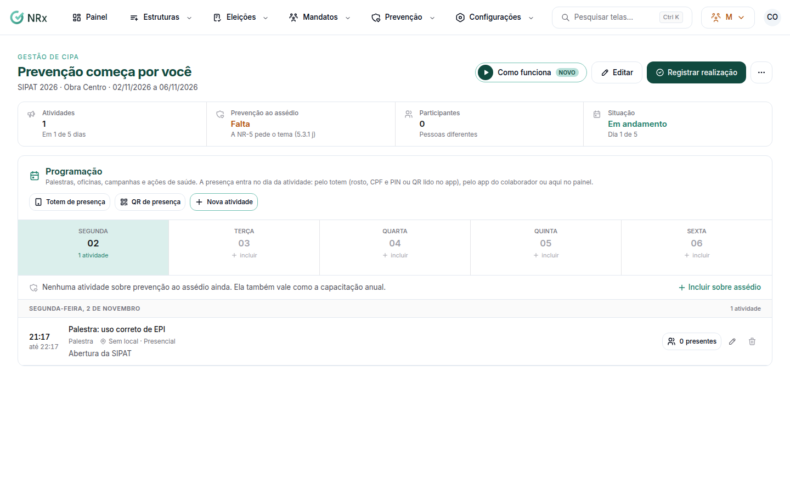

# Planejar a SIPAT

**Para que serve:** criar a SIPAT da unidade no ano e montar a programação: palestras, oficinas, campanhas e ações de saúde.


**Quem pode fazer:** Supervisor, Gestor ou Administrador, com a permissão de planejar a SIPAT. Para só ver: a permissão de ver mandatos.


## Antes de começar

* É uma SIPAT por unidade por ano, pelo ano do início.

## Passo a passo



### Crie a SIPAT

Clique em **Mandatos › SIPAT** e depois em **Nova SIPAT**. Escolha a unidade e o período.

<figure><figcaption>
SIPAT
</figcaption></figure>



### Monte a programação

Clique em **Nova atividade** (ou escolha um dia e use **Incluir atividade neste dia**). Inclua uma atividade sobre assédio: a NR-5 pede o tema (5.3.1 j), e ela vale como a capacitação anual (Lei 14.457).



### Registre a realização

No fim, clique em **Registrar realização**. Conte como foi no **Relatório (opcional)**: atividades realizadas, adesão, pontos de melhoria. Aparece "SIPAT registrada como realizada.".



## Dúvidas comuns

Como marco a presença?

Pelo totem, pelo QR ou pelo app. Veja [Registrar a presença na SIPAT](presenca-sipat.md).

Preciso cancelar a SIPAT.

Use **Cancelar SIPAT** e confirme. A unidade fica sem SIPAT no ano até você criar outra.

