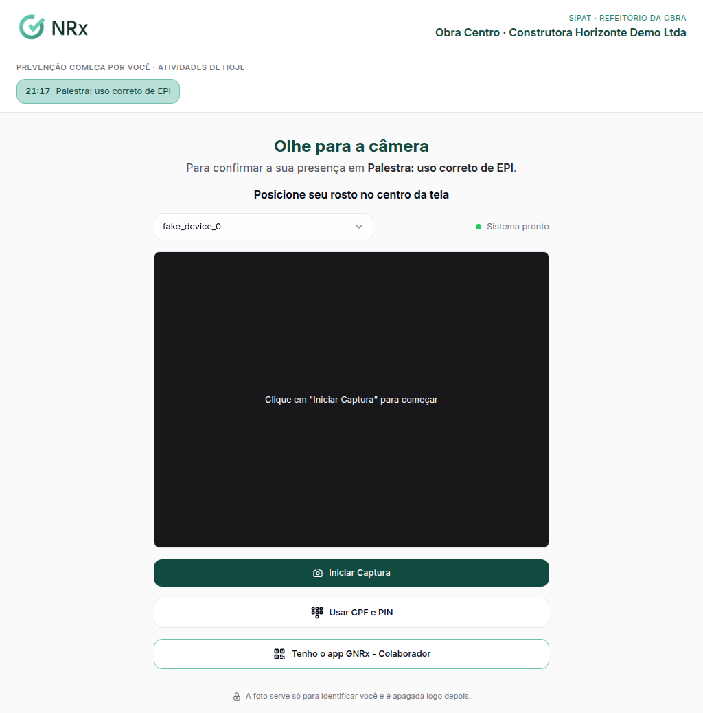

# Registrar a presença na SIPAT

**Para que serve:** deixar a presença das atividades ser marcada pelo totem, pelo QR de presença ou pelo app.


**Quem pode fazer:** Supervisor, Gestor ou Administrador, com a permissão de planejar a SIPAT. O colaborador marca a própria presença.


## Antes de começar

* Monte a [programação](planejar-sipat.md).

## Passo a passo



### Abra o totem do dia

Na SIPAT, clique em **Totem de presença**. Diga **Onde fica o tablet**, escolha **Como a pessoa se identifica** e clique em **Abrir totem para hoje**. Use **Abrir neste aparelho** ou **Copiar link** e abra no tablet.

<figure><figcaption>
Totem da SIPAT
</figcaption></figure>



### Ou use o QR

Em **QR de presença**, escolha a atividade e use **Tela cheia, para projetar** ou **Cartaz para imprimir**.



### O colaborador confirma

No totem: **Usar o reconhecimento facial**, **Usar CPF e PIN** ou **Tenho o app GNRx - Colaborador**. No aplicativo: aba **CIPA** › **SIPAT** › **Ler o QR de presença**. Aparece "Presença confirmada.".



## Deu errado?

| Mensagem na tela | O que fazer |
| --- | --- |
| "Este totem valia até o fim do dia. Peça à CIPA um novo link para hoje." | Abra um totem novo. |
| "Não há atividade da SIPAT marcada para hoje." | Confira a programação. |
| "Não foi possível identificar. Procure a equipe da CIPA." | Use CPF e PIN ou procure a equipe da CIPA. |
| "Este não é o QR de presença da SIPAT." | Leia o QR certo, no totem, na tela ou no cartaz. |

## Dúvidas comuns

O QR do cartaz vale quando?

Um cartaz por atividade vale só no dia e no horário dela. Um cartaz da SIPAT inteira vale nos dias da SIPAT.

Como desligo o totem?

Clique em **Desligar**. Aparece "Totem desligado.".

