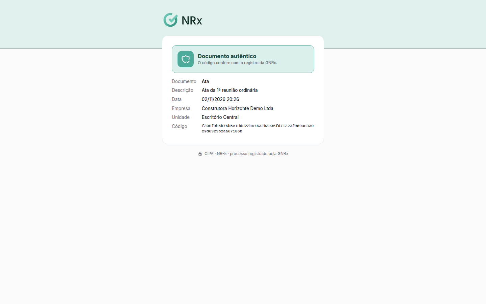

# Verificar um documento da CIPA

**Para que serve:** conferir se um documento da CIPA (ata, edital, dossiê) é autêntico, pelo QR Code ou pelo código.


**Quem pode fazer:** qualquer pessoa com o documento em mãos. Não precisa entrar no GNRx.


## Antes de começar

* Tenha o documento em PDF, com o QR Code ou o código de autenticidade.

## Passo a passo



### Abra a verificação

Aponte a câmera para o QR Code do documento, ou abra o link de verificação.



### Confira

Aparece **Documento autêntico**: "O código confere com o registro da GNRx.", com o documento, a descrição, a data, a empresa, a unidade e o código.

<figure><figcaption>
Documento autêntico
</figcaption></figure>



## Deu errado?


**"Código não encontrado"**: confira se o código foi copiado inteiro.


## Dúvidas comuns

Quem pode ver essa página?

Qualquer pessoa com o código ou o QR Code do documento.

O documento mudou depois de assinado?

O documento assinado não muda. Se a página não confirma, o documento não é o registrado.

