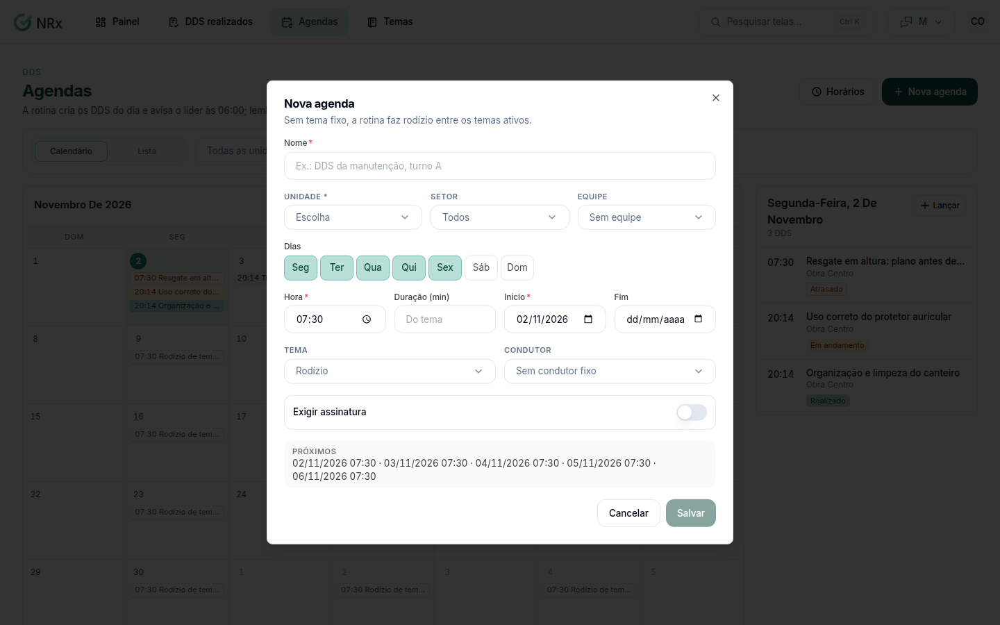

# Criar uma agenda de DDS

**Para que serve:** programar o DDS que se repete (ex.: todo dia útil às 7h), para ele entrar sozinho.


**Quem pode fazer:** Gestor ou Administrador, com a permissão de programar as agendas de DDS.


## Antes de começar

* Tenha os [temas](../temas/criar-tema.md) que vai usar.

## Passo a passo



### Clique em Nova agenda

Clique em **Agendas** e depois em **Nova agenda**.

<figure><figcaption>
Nova agenda
</figcaption></figure>



### Preencha

Dê um **Nome** (ex.: DDS da manutenção, turno A). Escolha o público: a equipe de um supervisor **ou** uma unidade (com setor opcional). Escolha os **Dias** (**Todos os dias** ou **Dias úteis**), a **Hora**, a **Duração (min)**, o **Início** e o **Fim**. Escolha o tema ou **Rodízio de temas**, o condutor (ou **Sem condutor fixo**): um colaborador **ou** um usuário do painel, nunca os dois. O condutor serve para a agenda de unidade ou para pôr alguém no lugar do supervisor e, se quiser, **Exigir assinatura**.



### Salve

Clique em **Salvar**. Aparece "Agenda criada.".



## Deu errado?

| Mensagem na tela | O que fazer |
| --- | --- |
| "Informe um condutor só: colaborador ou usuário." | Escolha só um dos dois. |
| "Unidade, setor, equipe ou condutor não pertencem à empresa (ou estão inativos)." | Confira as escolhas e troque o que estiver inativo. |

## Dúvidas comuns

Como paro uma agenda por um tempo?

Pause a agenda. Aparece "Agenda pausada.". Para ver as pausadas, ligue **Mostrar pausadas**.

Em que horário o DDS do dia é criado?

No horário da rotina. Veja [Ajustar os horários da rotina](horarios-da-rotina.md).

