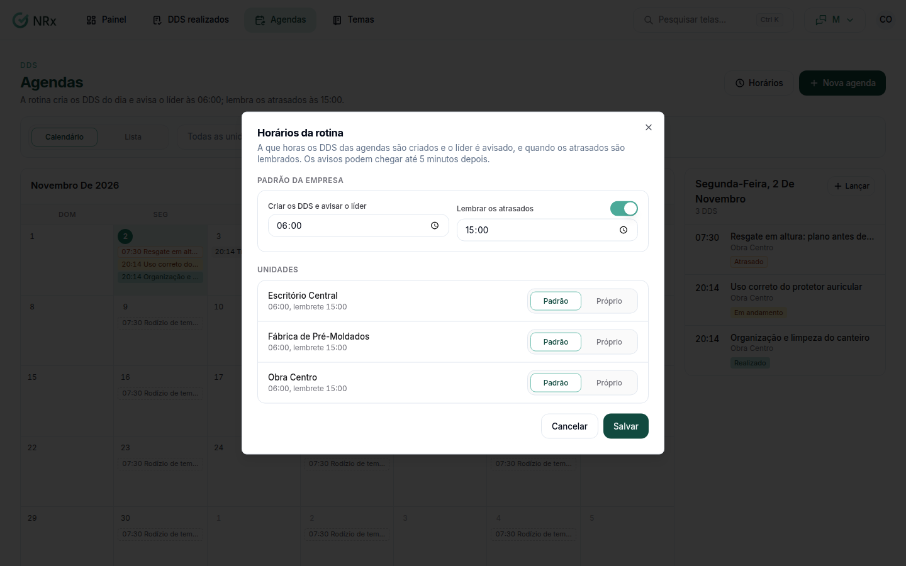

# Ajustar os horários da rotina

**Para que serve:** definir a hora em que a rotina cria os DDS do dia e avisa o líder, e a hora do lembrete dos atrasados.


**Quem pode fazer:** para ver, quem tem a permissão de ver DDS. Para alterar, Gestor ou Administrador, com a permissão de programar as agendas de DDS. O **Padrão da empresa** só é alterado pelo acesso Empresa (CNPJ).


## Antes de começar

* Você só vê e ajusta as unidades vinculadas a você.

## Passo a passo



### Abra os horários

Clique em **Agendas** e depois em **Horários**. Abre **Horários da rotina**.

<figure><figcaption>
Horários da rotina
</figcaption></figure>



### Ajuste os horários

Em **Criar os DDS e avisar o líder**, informe a hora. Em **Lembrar os atrasados**, ligue ou desligue o **Lembrete de atrasados** e informe a hora. Use minutos de 5 em 5, como 06:00, 06:05 ou 06:10.



### Ajuste por unidade (se precisar)

Em **Unidades**, preencha só as que têm horário diferente. Campo vazio usa o padrão da empresa. Limpar tudo apaga o ajuste da unidade.



### Salve

Salve. Aparece "Horários salvos.".



## Deu errado?


**"Só quem tem acesso a todas as unidades altera o padrão da empresa."**: o padrão da empresa é alterado pelo acesso Empresa (CNPJ). Ajuste só as suas unidades.


## Dúvidas comuns

O que a rotina faz?

Cria os DDS do dia, avisa o líder e lembra os atrasados.

Não vejo todas as unidades.

Você só vê as unidades vinculadas a você.

