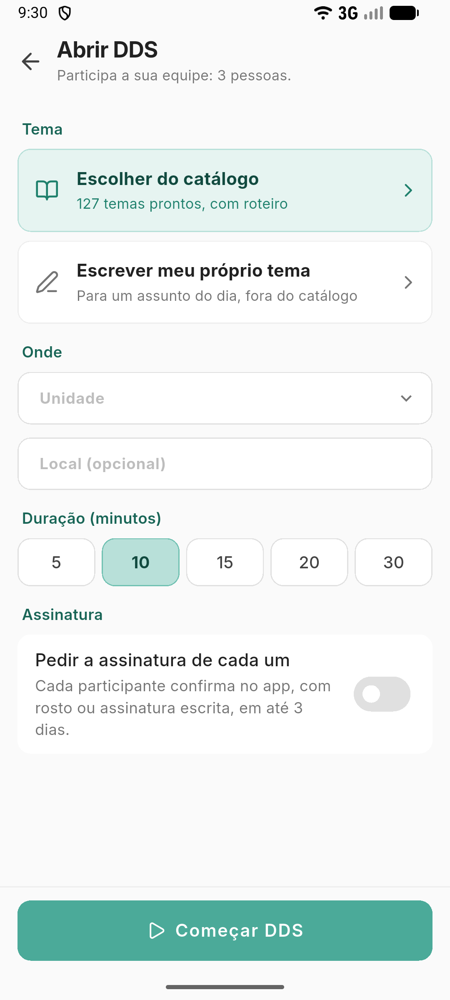
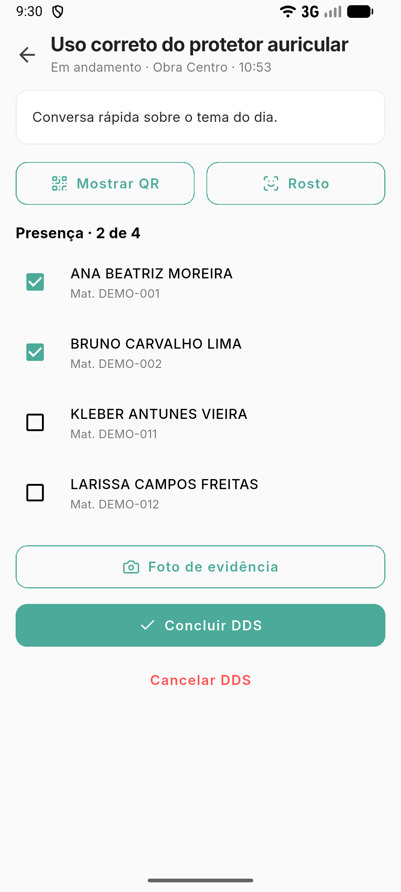

# Conduzir o DDS pelo aplicativo

**Para que serve:** abrir o DDS da equipe pelo celular, registrar quem esteve e concluir, mesmo sem internet.


**Quem pode fazer:** o líder ou o condutor do DDS, no **aplicativo GNRx Colaborador**.


## Antes de começar

* Tenha o aplicativo GNRx Colaborador no celular.

## Passo a passo



### Abra o DDS

No **Início** do aplicativo, toque em **DDS da equipe** (ou **DDS para conduzir**). Se ainda não há DDS hoje, toque em **Começar DDS**.

<figure><figcaption>
DDS da equipe
</figcaption></figure>



### Escolha o tema

Toque em **Escolher do catálogo** ou **Escrever meu próprio tema**. Confira a **Unidade**, o **Setor (opcional)**, o **Local (opcional)** e a **Duração (minutos)**. Se quiser, ligue **Pedir a assinatura de cada um**: cada participante confirma no app, com rosto ou assinatura escrita, em até 3 dias. Toque em **Iniciar DDS**.



### Registre a presença

Use **Rosto** para fotografar cada participante, ou **Mostrar QR** para cada um ler com o app, em **Pendências › DDS**. Se quiser, tire a **Foto de evidência**.

<figure><figcaption>
Presença no DDS
</figcaption></figure>



### Conclua

Toque em **Concluir DDS** e em **Concluir**. Aparece "DDS concluído.". Depois de concluído, a presença não muda mais pelo aplicativo.



## Deu errado?

| Mensagem na tela | O que fazer |
| --- | --- |
| "Sem internet: ficou salvo e vai quando a conexão voltar." | Siga normalmente. O DDS sobe quando a conexão voltar. |
| "O reconhecimento precisa de internet." / "O QR precisa de internet." | Conecte o celular ou marque a presença de outro jeito. |
| "Não foi possível reconhecer." | Fotografe de novo, com o rosto inteiro na tela. |
| "Escolha o tema do DDS." | Escolha ou escreva o tema. |

## Dúvidas comuns

O DDS não aconteceu.

Toque em **Não foi realizado**, escreva a **Justificativa** e confirme. O DDS sai da lista de hoje e não conta presença.

Quem participa?

A sua equipe. Quem está fora dela aparece como "fora da equipe".

