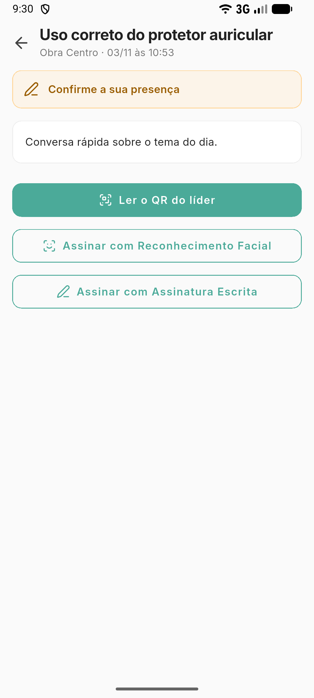

# Confirmar a presença no DDS

**Para que serve:** confirmar que você esteve no DDS, pelo QR do líder, pelo rosto ou com a sua assinatura.


**Quem pode fazer:** o colaborador que participou do DDS, no **aplicativo GNRx Colaborador**.


## Antes de começar

* Tenha o aplicativo GNRx Colaborador no celular.

## Passo a passo



### Abra a pendência

No aplicativo, abra **Pendências › DDS** e toque no DDS. Aparece **Confirme a sua presença**.

<figure><figcaption>
Confirme a sua presença
</figcaption></figure>



### Confirme

Toque em **Ler o QR do líder** e aponte para o QR na tela do celular do líder. Ou toque em **Assinar com Reconhecimento Facial** ou **Assinar com Assinatura Escrita**.



### Pronto

Aparece "Presença confirmada." ou **Você assinou este DDS**.



## Deu errado?

| Mensagem na tela | O que fazer |
| --- | --- |
| "Este não é o QR de presença do DDS." | Aponte para o QR certo, no celular do líder. |
| "Sem internet para confirmar pelo QR. Tente assinar." | Assine com o rosto ou com a assinatura escrita. |
| "Sem internet: a assinatura vai quando a conexão voltar." | Não precisa fazer nada. A assinatura sobe sozinha. |

## Dúvidas comuns

Aparece "Presença registrada · falta a sua assinatura".

O líder marcou a sua presença, mas o DDS pede assinatura. Assine com o rosto ou com a assinatura escrita.

Posso ver o material do tema?

Pode. Toque em **Abrir material do tema**.

