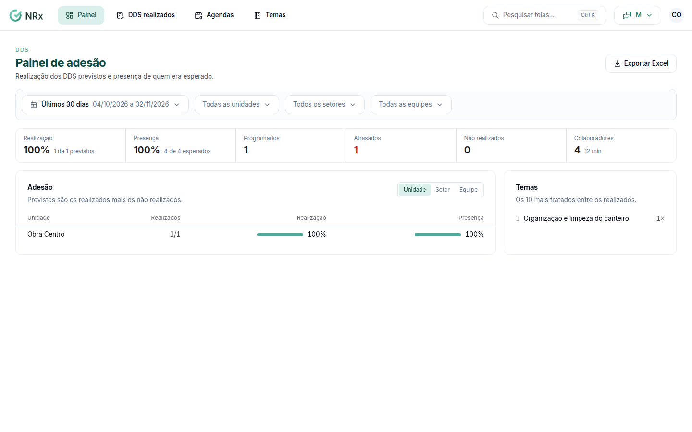

# Ver o painel de adesão

**Para que serve:** ver quantos DDS previstos foram realizados e a presença de quem era esperado, por unidade, setor e equipe.


**Quem pode fazer:** Supervisor, Gestor ou Administrador, com a permissão de ver o painel de adesão aos DDS.


## Antes de começar

* Nada a preparar.

## Passo a passo



### Abra o painel

Clique em **Painel**. Abre o **Painel de adesão**, com **Realização**, **Presença**, **Realizados** e **Não realizados**.

<figure><figcaption>
Painel de adesão
</figcaption></figure>



### Filtre

Escolha o período, a unidade, o setor e a equipe. Para levar os números, clique em **Exportar Excel**.



## Dúvidas comuns

O que são os previstos?

Previstos são os realizados mais os não realizados.

Apareceu "Nenhum DDS previsto no período."

Não houve DDS programado no período e nos filtros escolhidos.

