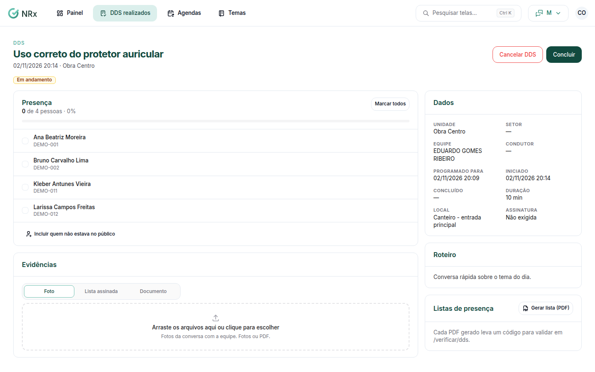

# Conduzir e concluir um DDS

**Para que serve:** iniciar o DDS, marcar quem esteve, anexar as evidências e concluir.


**Quem pode fazer:** Supervisor, Gestor ou Administrador, com a permissão de registrar e conduzir DDS.


## Antes de começar

* [Lance o DDS](lancar-dds.md) ou deixe a agenda criá-lo.

## Passo a passo



### Abra o DDS

Clique em **DDS realizados** e abra o DDS. Clique em **Iniciar**. Aparece "DDS iniciado.".

<figure><figcaption>
Detalhe do DDS
</figcaption></figure>



### Marque a presença

Marque quem esteve (ou **Marcar todos**). Para quem não estava no público, use **Incluir quem não estava no público**. Clique em **Salvar presença**. Aparece "Presença salva.".



### Anexe as evidências

Anexe a **Lista assinada** (escaneada ou fotografada), fotos da conversa ou outro documento. Só fotos e PDF são aceitos. Para gerar a lista, clique em **Gerar lista (PDF)**.



### Conclua

Clique em **Concluir**. Em **Concluir DDS**, escreva as observações, se quiser, e confirme. Aparece "DDS concluído.". A presença marcada agora é a que fica.



## Deu errado?


**"Só fotos e PDF são aceitos."**: envie a evidência como foto ou PDF.


## Dúvidas comuns

O DDS não aconteceu. E agora?

Clique em **Cancelar DDS**. Escolha **DDS não realizado** e escreva o motivo: fica registrado como não realizado. Ou cancele: o DDS sai da conta de realização.

Como alguém confere a lista?

O PDF tem um código de autenticidade. Veja [Verificar uma lista de presença](../verificacao/verificar-lista.md).

