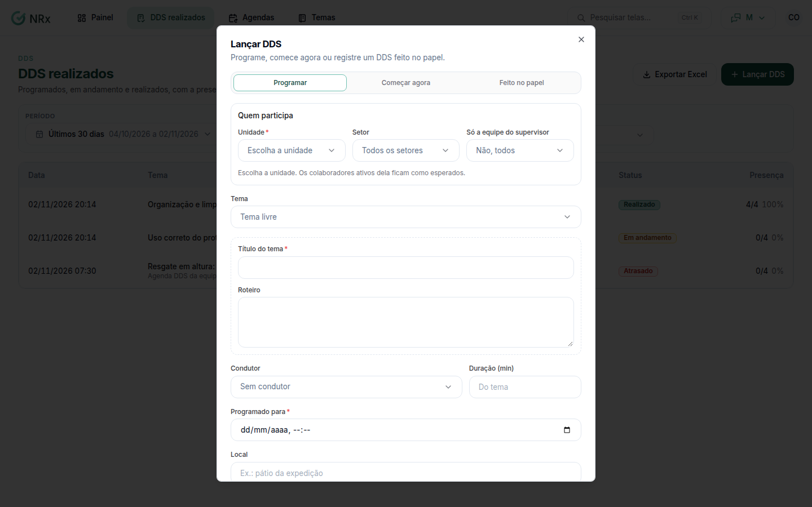

# Lançar um DDS

**Para que serve:** registrar um DDS: começar agora, programar para depois ou lançar um que foi feito no papel.


**Quem pode fazer:** Supervisor, Gestor ou Administrador, com a permissão de registrar e conduzir DDS.


## Antes de começar

* Se for usar um roteiro pronto, veja os [temas](../temas/criar-tema.md).

## Passo a passo



### Clique em Lançar DDS

Clique em **DDS realizados** e depois em **Lançar DDS**. Em **Como lançar**, escolha **Começar agora**, programar para depois ou **Feito no papel**.

<figure><figcaption>
Lançar DDS
</figcaption></figure>



### Diga quem participa

Escolha a unidade. Os colaboradores ativos dela ficam como esperados. Em **Quem participa**, escolha **Só a equipe do supervisor** ou **Não, todos**.



### Escolha o tema

Escolha um tema do catálogo ou **Tema livre** (escreva o **Título do tema** e o **Roteiro**). Ajuste a **Duração (min)**, o **Local** (ex.: pátio da expedição), o condutor e as **Observações**. Se quiser, ligue **Exigir assinatura**.



### Lance

Clique em **Lançar**. Aparece "DDS em andamento.", "DDS programado." ou "DDS lançado. Marque os presentes e anexe a lista assinada.".



Depois, [conduza e conclua o DDS](conduzir-dds.md).

## Dúvidas comuns

O DDS de todo dia precisa ser lançado à mão?

Não. Crie uma [agenda](../agendas/criar-agenda.md) e o DDS entra sozinho.

Posso lançar pelo celular?

Pode. O líder conduz pelo aplicativo. Veja [Conduzir o DDS pelo aplicativo](../aplicativo/conduzir-pelo-app.md).

