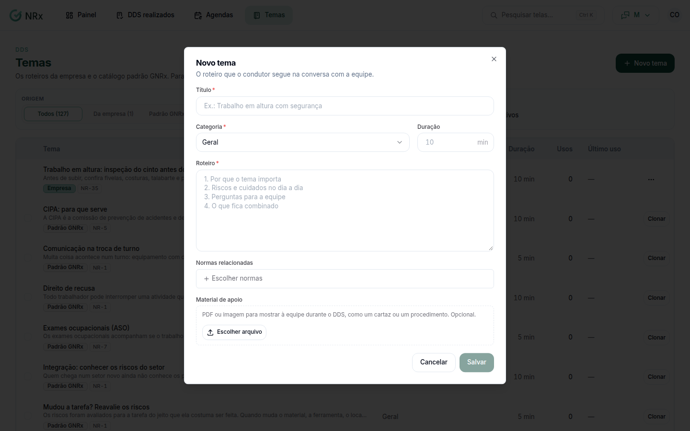

# Criar um tema de DDS

**Para que serve:** cadastrar o roteiro que o condutor segue na conversa com a equipe.


**Quem pode fazer:** Gestor ou Administrador, com a permissão de cadastrar os temas de DDS.


## Antes de começar

* Veja se um tema **Padrão GNRx** já serve.

## Passo a passo



### Clique em Novo tema

Clique em **Temas** e depois em **Novo tema**.

<figure><figcaption>
Novo tema
</figcaption></figure>



### Preencha

Preencha o **Título** (ex.: Trabalho em altura com segurança), a duração em minutos e o **Roteiro**. Se quiser, escolha as **Normas relacionadas** (busque pelo número ou nome, ex.: 35 ou altura) e anexe o **Material de apoio**.



### Salve

Clique em **Salvar**. Aparece "Tema criado.".



## Dúvidas comuns

Posso mudar um tema padrão GNRx?

Não direto. Clone o tema para a empresa e ajuste. Aparece "Tema clonado para a empresa.".

Como tiro um tema da lista?

Inative o tema. Aparece "Tema inativado.". Para ver os inativos, ligue **Mostrar inativos**.

