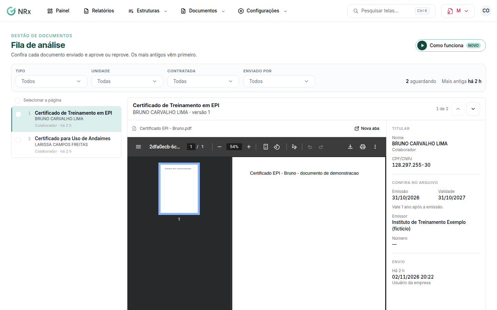

# Analisar os documentos enviados

**Para que serve:** conferir cada documento enviado e aprovar ou reprovar. Os mais antigos vêm primeiro.


**Quem pode fazer:** Gestor ou Administrador, com a permissão de aprovar e reprovar documentos enviados. Documentos sensíveis só abrem com a permissão de abrir documentos de saúde.


## Antes de começar

* Nada a preparar. Novos envios aparecem na fila.

## Passo a passo



### Abra a fila

Clique em **Documentos › Fila de análise**. Escolha um documento. Use **Anterior (↑)** e **Próximo (↓)** para andar pela fila.

<figure><figcaption>
Fila de análise
</figcaption></figure>



### Confira o arquivo

Clique em **Abrir arquivo** e confira com os dados enviados.



### Decida

Clique em **Aprovar**. Ou clique em **Reprovar**, escolha o **Motivo** e escreva o que quem enviou precisa corrigir.



## Deu errado?

| Mensagem na tela | O que fazer |
| --- | --- |
| "Você não tem permissão para abrir documentos sensíveis." | Peça a quem tem a permissão de abrir documentos de saúde. |
| "Está num fluxo de aprovação; decida pela tela de aprovações." | Use **Decidir em Aprovações**. |

## Dúvidas comuns

Posso aprovar vários de uma vez?

Pode. Marque os documentos (ou **Selecionar a página**) e use **Aprovar em lote** ou **Reprovar em lote**.

Apareceu "Fila zerada".

Nenhum documento aguardando análise. Novos envios aparecem aqui.

