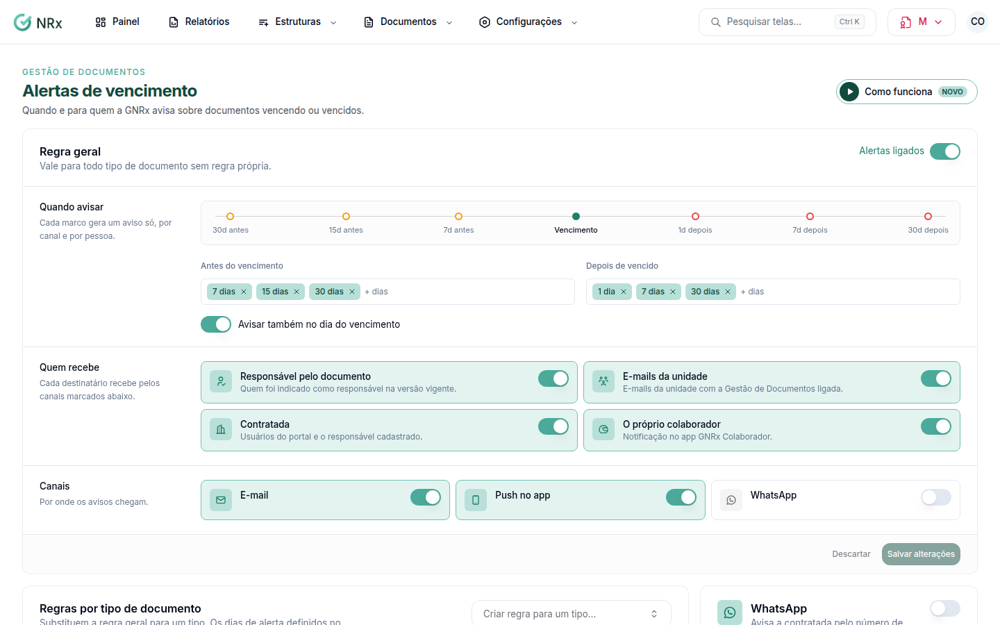

# Configurar os alertas de vencimento

**Para que serve:** definir quando e para quem o GNRx avisa sobre documentos vencendo ou vencidos.


**Quem pode fazer:** Gestor ou Administrador, com a permissão de editar alertas e política de bloqueio documental.


## Antes de começar

* A **Regra geral** vale para todo tipo de documento sem regra própria.

## Passo a passo



### Diga quando avisar

Clique em **Configurações › Alertas**. Em **Quando avisar**, informe os dias **Antes do vencimento** e **Depois de vencido**. Se quiser, ligue **Avisar também no dia do vencimento**.

<figure><figcaption>
Alertas de vencimento
</figcaption></figure>



### Diga quem recebe

Em **Quem recebe**, marque o **Responsável pelo documento**, os **E-mails da unidade**, os usuários do portal da contratada e **O próprio colaborador** (notificação no app). Escolha os canais e salve. Aparece "Alertas salvos.".



## Dúvidas comuns

Um tipo de documento precisa de outro aviso.

Em **Regras por tipo de documento**, use **Criar regra para um tipo…**.

Como aviso por WhatsApp?

Em **WhatsApp**, informe o **Template de vencimento aprovado na Meta** (ex.: vencimento_documento) e salve.

