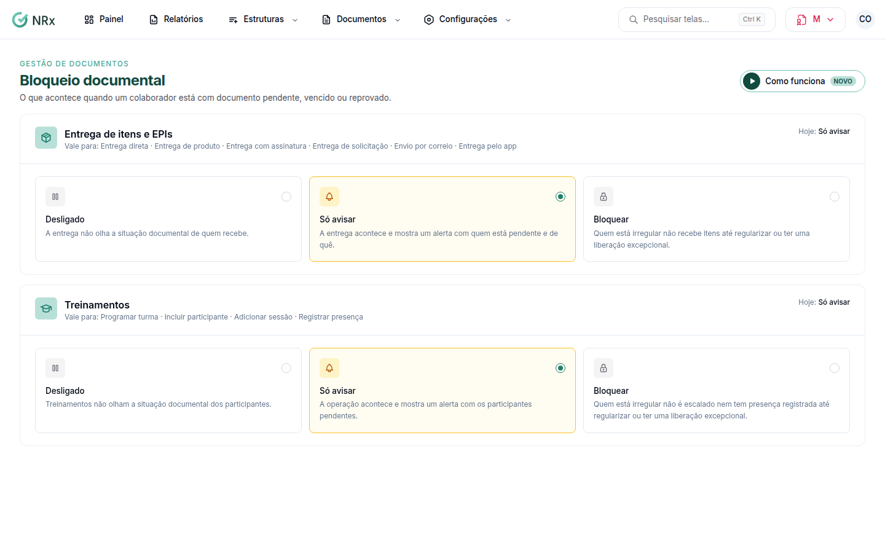

# Configurar o bloqueio documental

**Para que serve:** decidir o que acontece quando um colaborador está com documento pendente, vencido ou reprovado: nada, só um aviso, ou o bloqueio.


**Quem pode fazer:** Gestor ou Administrador, com a permissão de editar alertas e política de bloqueio documental.


## Antes de começar

* Monte a [matriz de exigência](matriz-de-exigencia.md).

## Passo a passo



### Abra o bloqueio

Clique em **Configurações › Bloqueio**.

<figure><figcaption>
Bloqueio documental
</figcaption></figure>



### Escolha por operação

Para cada operação (entrega direta, entrega de produto, entrega com assinatura, entrega de solicitação, envio por correio, entrega pelo app, programar turma, incluir participante, adicionar sessão e registrar presença), escolha:

* a operação não olha a situação documental;
* a operação acontece e mostra um alerta com quem está pendente;
* quem está irregular fica bloqueado até regularizar ou ter uma liberação excepcional.

Clique em **Salvar alterações**. Aparece "Política de bloqueio salva.".



## Dúvidas comuns

A pessoa precisa trabalhar com documento pendente.

Peça uma [liberação excepcional](../liberacoes/solicitar-liberacao.md).

Vale para quais módulos?

Para as entregas da Gestão de EPI e para as operações de Treinamentos.

