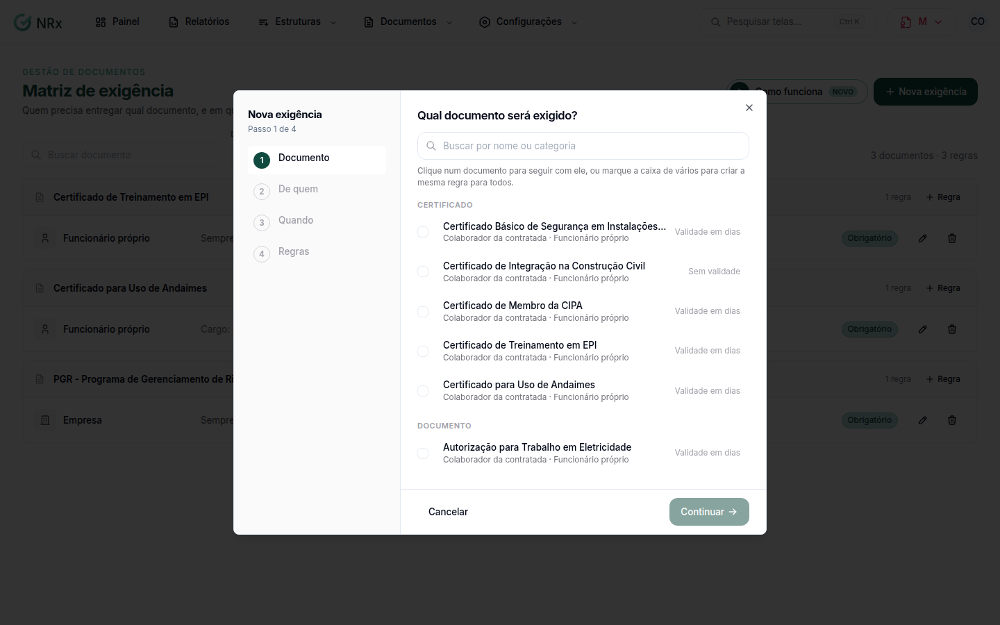

# Montar a matriz de exigência

**Para que serve:** dizer quem precisa entregar cada documento e em quais casos. Ex.: ASO de todo funcionário próprio.


**Quem pode fazer:** Gestor ou Administrador, com a permissão de editar a matriz de exigência. Todas as roles podem ver.


## Antes de começar

* Cadastre os [tipos de documento](tipos-de-documento.md).

## Passo a passo



### Comece a exigência

Clique em **Configurações › Matriz de exigência** e depois em **Nova exigência**. Em **Qual documento será exigido?**, busque o documento.

<figure><figcaption>
Nova exigência
</figcaption></figure>



### De quem

Em **De quem ele é exigido?**, escolha: a sua própria empresa, cada unidade, a empresa terceira contratada, cada pessoa da equipe terceirizada ou cada colaborador da sua empresa.



### Em quais casos

Escolha **Todos os casos** ou uma condição: uma unidade, um GHE exposto a um risco, um cargo, uma contratada ou um tipo de serviço.



### Como cobrar

Escolha se é obrigatório (se faltar, o titular fica irregular) ou não (se faltar, fica pendente, nunca irregular). Se quiser, informe o **Prazo para entregar após a admissão**. Clique em **Criar exigência**. Aparece "Exigência criada.".



## Dúvidas comuns

Posso copiar a matriz para outras unidades?

Pode. Use **Copiar a matriz da unidade** e escolha as unidades.

Como deixo de exigir um documento?

Inative a regra. Ela deixa de ser exigida, e a situação dos titulares é recalculada.

