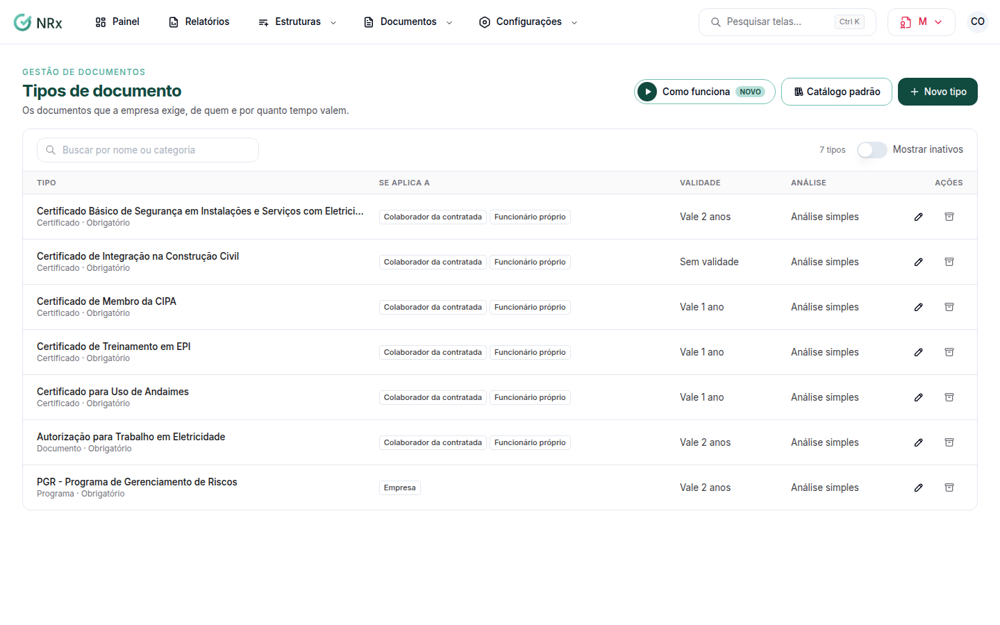

# Cadastrar um tipo de documento

**Para que serve:** dizer quais documentos a empresa exige, de quem e por quanto tempo valem.


**Quem pode fazer:** Gestor ou Administrador, com a permissão de criar tipos de documento.


## Antes de começar

* Comece pelo catálogo padrão: ele já traz os documentos mais comuns, prontos para ajustar.

## Passo a passo



### Use o catálogo ou crie

Clique em **Configurações › Tipos de documento**. Clique em **Catálogo padrão**, marque os documentos e clique em **Adicionar à empresa**. Ou clique em **Novo tipo**.

<figure><figcaption>
Tipos de documento
</figcaption></figure>



### Preencha

Informe o nome (ex.: Atestado de Saúde Ocupacional (ASO)), a categoria e a quem **Se aplica a**. Em **Validade e alertas**, informe a validade em dias e quando avisar. Em **Análise e regras**, decida se é **Obrigatório por padrão** e se é **Dado sensível (LGPD)**. Se quiser, escreva as **Instruções de envio** e anexe um **Arquivo de exemplo**.



### Salve

Clique em **Salvar tipo**. Aparece "Tipo criado.".



## Deu errado?

| Mensagem na tela | O que fazer |
| --- | --- |
| "Informe o nome." / "Informe a categoria." | Preencha. |
| "Escolha a quem o documento se aplica." | Marque um ou mais. |
| "Informe a validade em dias." | Preencha a validade. |
| "O dia limite da competência vai de 1 a 28." | Ajuste o dia. |

## Dúvidas comuns

Um certificado de treinamento vale como documento?

Vale. Em **Treinamentos que cumprem**, escolha os treinamentos cujo certificado vale como este documento.

O que muda se eu marcar Dado sensível?

Abrir o arquivo exige permissão própria, e cada abertura fica registrada.

