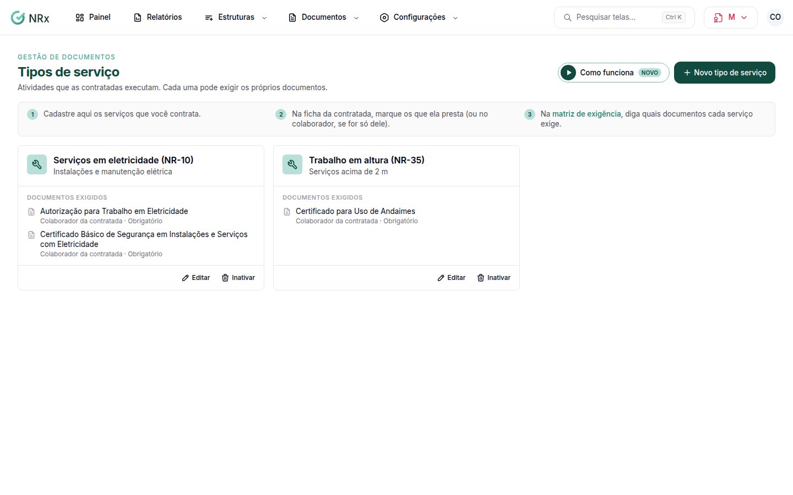

# Cadastrar os tipos de serviço

**Para que serve:** cadastrar as atividades que as contratadas executam (ex.: trabalho em altura). Cada uma pode exigir os próprios documentos.


**Quem pode fazer:** Gestor ou Administrador, com a permissão de editar a matriz de exigência e os tipos de serviço.


## Antes de começar

* Nada a preparar.

## Passo a passo



### Crie o tipo de serviço

Clique em **Configurações › Tipos de serviço** e depois em **Novo tipo de serviço**. Ou comece por um sugerido (ex.: Trabalho em altura (NR-35), Eletricidade (NR-10)). Informe o **Nome** e, se quiser, a descrição. Clique em **Salvar**. Aparece "Tipo de serviço salvo.".

<figure><figcaption>
Tipos de serviço
</figcaption></figure>



### Diga o que ele exige

Na [matriz de exigência](matriz-de-exigencia.md), crie as exigências com a condição **Contratadas que prestam um tipo de serviço**.



## Dúvidas comuns

Onde marco o serviço da contratada?

No cadastro da contratada. O tipo de serviço aparece para vincular.

Inativei um tipo de serviço.

Ele deixa de aparecer para vincular às contratadas.

