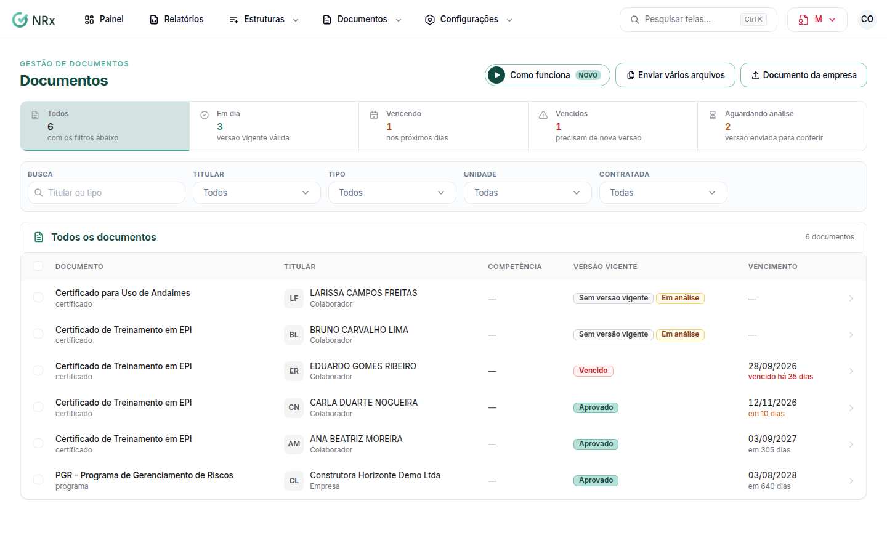

# Encontrar um documento

**Para que serve:** ver todos os documentos recebidos e o que está em dia, vencendo, vencido ou aguardando análise.


**Quem pode fazer:** todas as roles, com a permissão de ver documentos e a situação documental.



**Dado sensível (LGPD):** ASO, atestado e outros documentos de saúde só abrem para Gestor e Administrador, com a permissão de abrir documentos de saúde.


## Antes de começar

* Os documentos aparecem quando alguém envia o primeiro arquivo de um titular.

## Passo a passo



### Abra a lista

Clique em **Documentos › Documentos**. O topo mostra **Documentos em dia**, **Documentos vencendo**, **Documentos vencidos** e **Documentos aguardando análise**.

<figure><figcaption>
Documentos
</figcaption></figure>



### Filtre e abra

Use a **Busca** (titular ou tipo) e os filtros. **Em até (dias)** mostra o que vence nesse prazo. Clique no documento para abrir as versões, a análise e o histórico.



## Dúvidas comuns

Como vejo como um documento estava num dia do passado?

Abra o documento e use **Consultar uma data**.

Como tiro um documento que não vale mais?

Abra o documento e use **Inativar documento**. Para vários, use **Inativação em lote** na lista. Precisa da permissão de inativar documentos (Gestor e Administrador).

