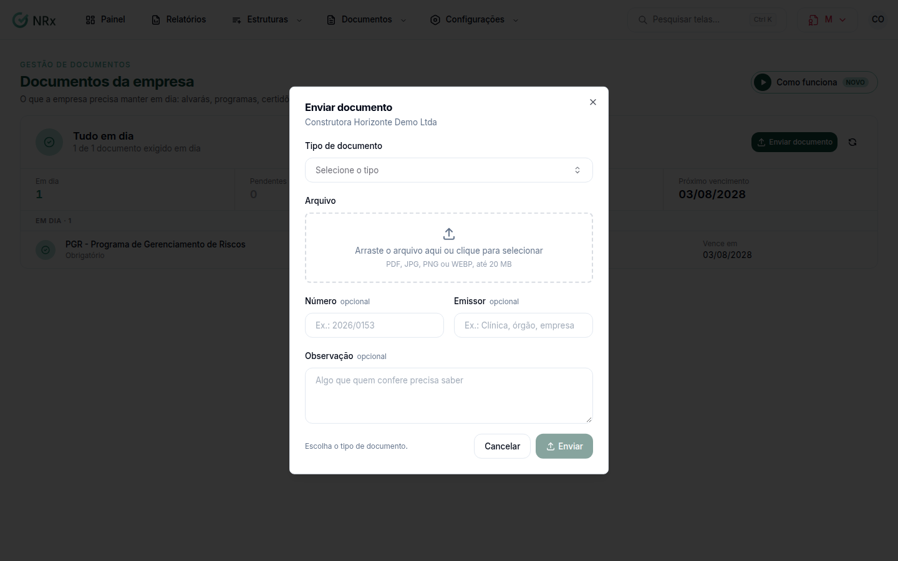

# Enviar um documento

**Para que serve:** enviar o arquivo de um documento exigido, ou uma nova versão quando ele vence ou é reprovado.


**Quem pode fazer:** Supervisor, Gestor ou Administrador, com a permissão de enviar documentos e novas versões.


## Antes de começar

* Arquivo em PDF, JPG, PNG ou WEBP, até 20 MB.

## Passo a passo



### Abra o envio

Na lista, clique em **Documento da empresa**, ou abra o documento e clique em **Enviar nova versão**. Também dá para enviar pela situação do titular, em **Enviar documento**.

<figure><figcaption>
Enviar documento
</figcaption></figure>



### Preencha

Escolha o **Tipo de documento** e anexe o **Arquivo**. Conforme o tipo, informe o **Mês de competência** ou a **Data de emissão** e a validade. Se quiser, preencha **Número** (ex.: 2026/0153), **Emissor** e **Observação**.



### Envie

Clique em **Enviar**. O resultado depende do tipo:

* **Enviado para análise:** a versão entra na fila de análise e vale depois de aprovada;
* **Documento aprovado:** este tipo não passa por análise, e a versão já está valendo;
* **Enviado para o fluxo de aprovação:** quem decide recebe a solicitação na tela de aprovações.



## Deu errado?

| Mensagem na tela | O que fazer |
| --- | --- |
| "Anexe o arquivo do documento." | Anexe o arquivo. |
| "Envie um arquivo PDF, JPG, PNG ou WEBP." | Troque o formato. |
| "A data de emissão não pode ser futura." | Corrija a data. |
| "A validade não pode ser anterior à emissão." | Corrija as datas. |
| "Este tipo de documento não está mais ativo." | Escolha outro tipo. |

## Dúvidas comuns

Tenho muitos arquivos do mesmo tipo.

Na lista, use **Enviar vários arquivos**. Escolha de quem são os documentos e o **Tipo de documento (o mesmo para todos)**, arraste os arquivos, confira e clique em **Continuar**. Use **Aplicar a todos** para as datas iguais.

O documento foi reprovado.

Corrija o que o motivo pede e envie uma nova versão.

