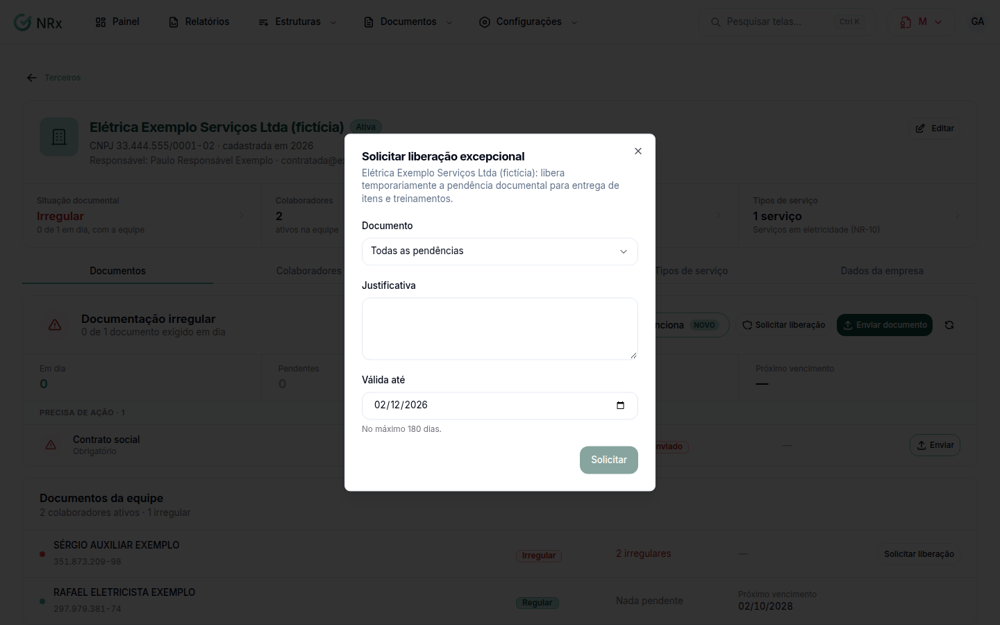

# Pedir uma liberação excepcional

**Para que serve:** deixar quem tem documento pendente seguir trabalhando, sem bloqueio, até uma data. Ex.: o ASO está agendado e a pessoa precisa começar antes.


**Quem pode fazer:** para pedir, um usuário Supervisor, Gestor ou Administrador, com a permissão de solicitar liberação. O acesso Empresa (login com o CNPJ) não pede liberação. Para aprovar ou reprovar: Gestor ou Administrador, com a permissão de aprovar liberação (ou pelo fluxo de aprovação). Para ver: a permissão de ver documentos.


## Antes de começar

* **Solicitar liberação** só aparece para quem está com a documentação irregular, na ficha da contratada ou na lista da equipe.
* A liberação vale no máximo 180 dias.

## Passo a passo



### Peça na ficha

Abra a ficha da contratada ou do colaborador e clique em **Solicitar liberação**. Em **Solicitar liberação excepcional**, escolha o **Documento** (ou **Todas as pendências**), escreva a **Justificativa** e informe **Válida até**. Clique em **Solicitar**.

<figure><figcaption>
Solicitar liberação excepcional
</figcaption></figure>



### Acompanhe

Clique em **Documentos › Liberações**. O pedido fica **Aguardando aprovação** até alguém decidir, e depois **Aprovada** ou **Reprovada**. A aprovada vale até a data escolhida e depois vence sozinha.



## Dúvidas comuns

Quem decide?

O pedido vai para o fluxo de aprovação. Aparece "Liberação enviada para o fluxo de aprovação.".

Entrei com o CNPJ e não vejo o botão.

No acesso Empresa, **Solicitar liberação** não aparece. Entre com o seu usuário.

O documento foi aprovado. A liberação acaba?

Não. Ela só deixa de ser necessária e vence na data escolhida.

