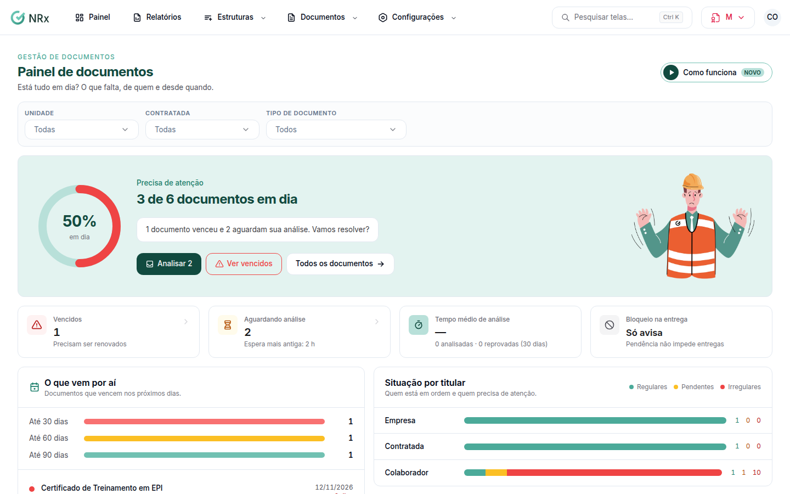

# Ver o painel de documentos

**Para que serve:** ver se está tudo em dia: o que falta, de quem e desde quando.


**Quem pode fazer:** Supervisor, Gestor ou Administrador, com a permissão de ver o painel de gestão de documentos.


## Antes de começar

* Nada a preparar.

## Passo a passo



### Abra o painel

Clique em **Painel**. Abre o **Painel de documentos**, com a situação (**Precisa de atenção**, **Falta reenviar**, **Quase tudo certo** ou **Tudo em dia**).

<figure><figcaption>
Painel de documentos
</figcaption></figure>



### Veja os números

Veja o que **Precisam ser renovados**, o que está **Aguardando análise**, o **Tempo médio de análise** e os **Colaboradores bloqueados** (quem não recebe itens por pendência).



## Dúvidas comuns

Apareceu "Tudo em dia".

Nenhum documento vencido nem esperando análise. Bom trabalho!

Por que ninguém aparece como bloqueado?

O bloqueio pode estar como **Só avisa**. Veja [Configurar o bloqueio documental](../configuracoes/bloqueio-documental.md).

