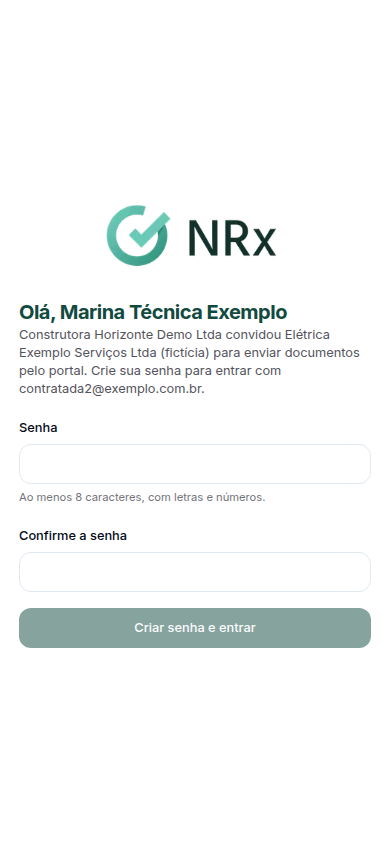

# Aceitar o convite e entrar

**Para que serve:** criar a sua senha e entrar no portal da contratada pela primeira vez.


**Quem pode fazer:** a pessoa da empresa terceira que recebeu o convite por e-mail.


## Antes de começar

* Abra o e-mail do convite.

## Passo a passo



### Abra o convite

Clique no link do e-mail. Abre **Aceitar convite**.

<figure><figcaption>
Aceitar convite
</figcaption></figure>



### Crie a senha

Digite a **Senha** (ao menos 8 caracteres, com letras e números) e repita em **Confirme a senha**. Clique em **Criar senha e entrar**.



### Nas próximas vezes

Abra o portal, digite o e-mail do convite e a senha. Se você ligou o autenticador, digite também o código de 6 dígitos.



## Deu errado?

| Mensagem na tela | O que fazer |
| --- | --- |
| "O link expirou ou já foi usado." | Peça um novo convite à contratante. |
| "As senhas não conferem." | Digite a mesma senha nos dois campos. |
| "Não foi possível entrar. Tente novamente." | Confira o e-mail e a senha. |

## Dúvidas comuns

Já uso o portal com outra contratante.

Aparece "Convite aceito. Entre com a senha que você já usa.". Entre com a mesma senha.

Trabalho para mais de uma contratante.

No topo, em **Trabalhando para**, escolha para quem você está enviando.

