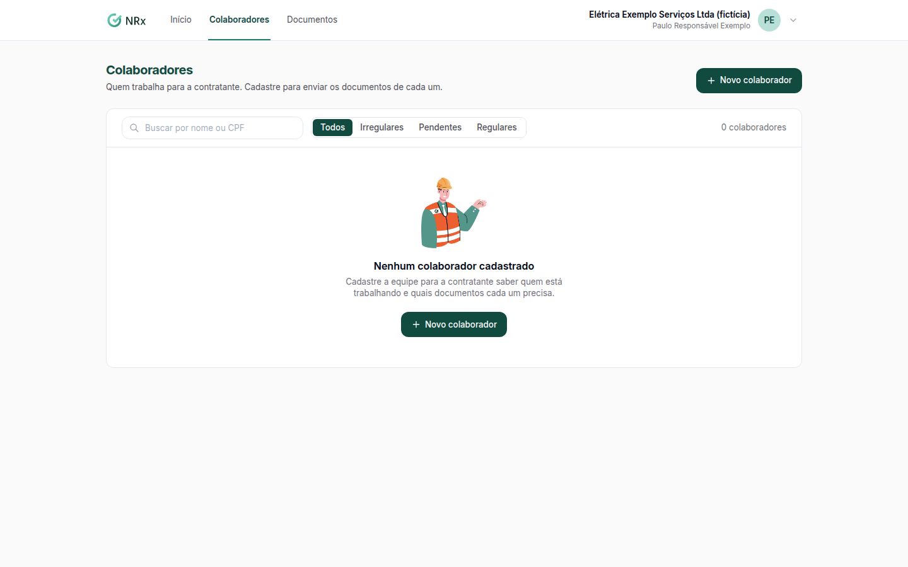

# Cadastrar a equipe

**Para que serve:** dizer à contratante quem da sua empresa está trabalhando, para enviar os documentos de cada um.


**Quem pode fazer:** quem tem acesso ao portal da contratada.


## Antes de começar

* Tenha o nome, o CPF e a data de admissão de cada pessoa.

## Passo a passo



### Abra a equipe

No portal, clique em **Colaboradores** (ou em **Cadastrar colaboradores**, no início).

<figure><figcaption>
Colaboradores
</figcaption></figure>



### Cadastre

Clique em **Novo colaborador**. Preencha **Nome** e **CPF** (obrigatórios) e, se quiser, **Telefone**, **E-mail** e **Admissão**. Clique em **Salvar**. Aparece "Colaborador cadastrado.".



### Veja o que é pedido

Clique no colaborador para ver o que a contratante pede dele.



## Deu errado?

| Mensagem na tela | O que fazer |
| --- | --- |
| "Informe o nome do colaborador." | Preencha o nome. |
| "CPF inválido." | Confira o CPF. |
| "E-mail inválido." / "Telefone inválido." | Confira ou deixe em branco. |
| "Já existe um colaborador com este CPF na sua empresa." | Ele já está cadastrado. Procure na lista. |

## Dúvidas comuns

A pessoa saiu da empresa.

Tire o colaborador do portal. Ele deixa de aparecer e de ter documentos exigidos.

Errei um dado.

Clique em **Editar** no colaborador. Aparece "Colaborador atualizado.".

