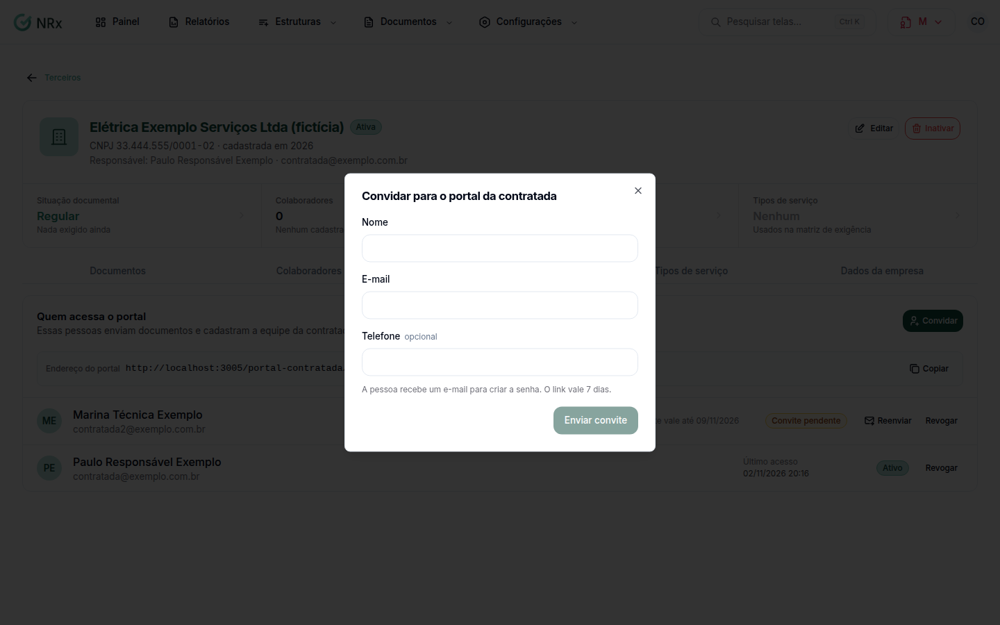

# Convidar a contratada para o portal

**Para que serve:** dar à empresa terceira um acesso próprio para ela mesma enviar os documentos.


**Quem pode fazer:** Gestor ou Administrador, com a permissão de convidar e revogar acessos ao portal da contratada.


## Antes de começar

* Cadastre a [empresa terceira](../estruturas/terceiros/criar-terceiro.md).

## Passo a passo



### Abra a contratada

Clique em **Estruturas › Terceiros** e abra a contratada. Em **Acesso ao portal**, clique em **Convidar a primeira pessoa**.

<figure><figcaption>
Acesso ao portal
</figcaption></figure>



### Envie o convite

Em **Convidar para o portal da contratada**, informe o **Nome**, o **E-mail** e o **Telefone**. Clique em **Enviar convite**. A pessoa recebe o convite, cria a senha e entra no portal.



## Deu errado?


**"O acesso foi criado, mas o e-mail do convite falhou."**: clique em **Reenviar**.


## Dúvidas comuns

Como vejo se a pessoa já entrou?

Em **Quem acessa o portal**, aparece **Convite pendente**, **Nunca entrou** ou se ela **Usa autenticador**.

Como tiro o acesso de alguém?

Revogue o acesso. A pessoa perde na hora o acesso aos documentos desta contratada.

