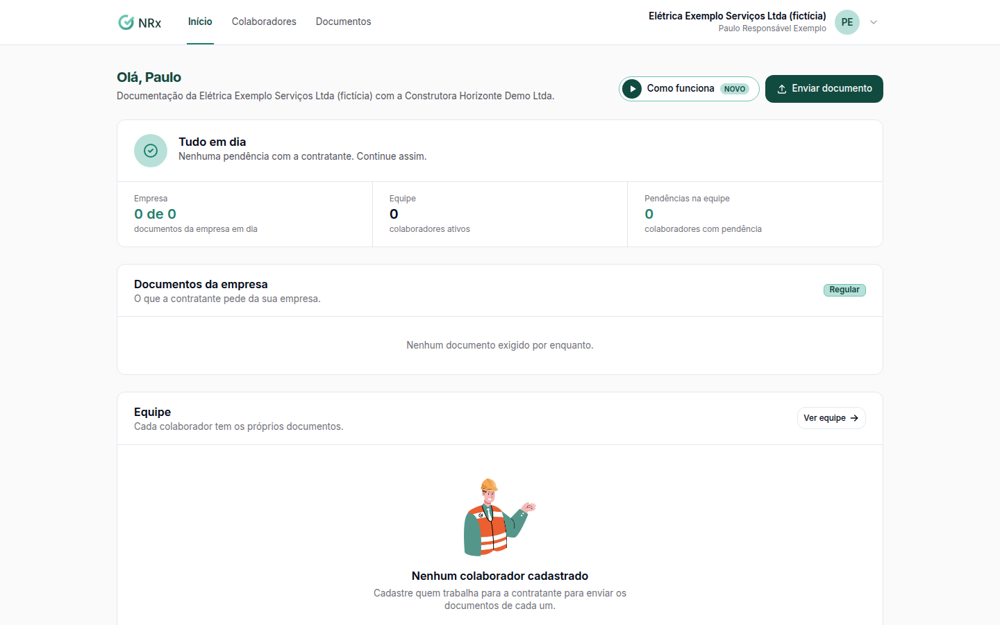

# Enviar um documento pelo portal

**Para que serve:** enviar os documentos que a contratante pede, da sua empresa e de cada colaborador, e reenviar os reprovados.


**Quem pode fazer:** quem tem acesso ao portal da contratada.


## Antes de começar

* Arquivo em PDF, JPG, PNG ou WEBP, até 20 MB.

## Passo a passo



### Veja o que falta

No **Início do portal**, a situação aparece como **Tudo em dia**, **Há documentos para enviar** ou **Documentação irregular**. Veja os **Documentos da empresa** e as **Pendências na equipe**.

<figure><figcaption>
Início do portal
</figcaption></figure>



### Envie

Clique em **Documentos** e em **Enviar documento**. Escolha de quem é, o tipo, anexe o arquivo e preencha as datas. Para vários arquivos do mesmo tipo, use **Enviar vários arquivos**.



### Acompanhe a análise

O envio passa pela análise da contratante: conforme o tipo, ele é aprovado na hora ou fica **Aguardando análise**. Você não recebe aviso da análise: entre no portal para ver se foi aprovado.




**Documentação irregular** (documento vencido, reprovado ou fora do prazo) pode bloquear o trabalho da equipe na contratante.


## Deu errado?

| Situação | O que fazer |
| --- | --- |
| Documento reprovado | Abra o documento, leia o motivo e clique em **Reenviar corrigido**. |
| Documento vencendo | Abra o documento e clique em **Enviar nova versão**. |
| "O servidor não respondeu. Confira sua internet e tente de novo em instantes." | Confira a internet e tente de novo. |

## Dúvidas comuns

Recebo algum aviso?

Só de vencimento, por e-mail (e por WhatsApp, se a contratante configurar). A aprovação e a reprovação você vê entrando no portal.

Onde vejo as versões antigas?

Abra o documento. Em **Versões enviadas**, da mais recente para a mais antiga.

