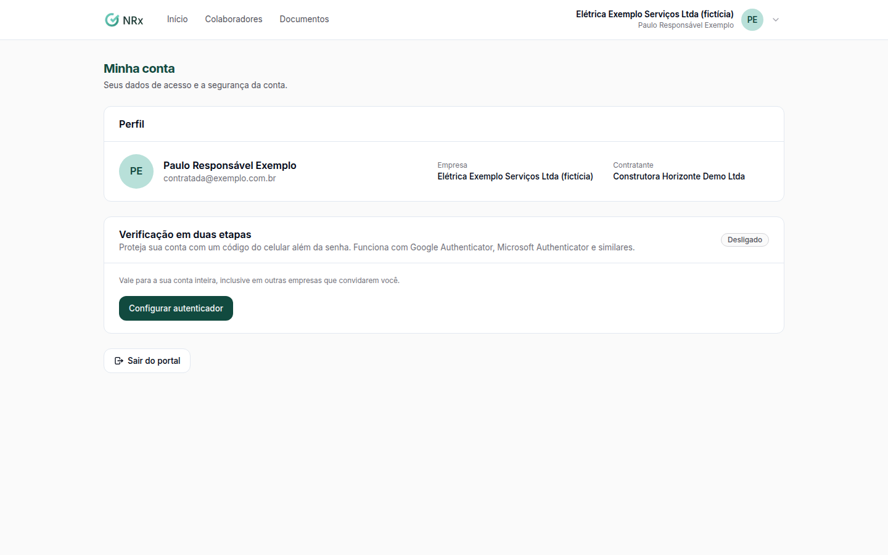

# Proteger a conta do portal

**Para que serve:** pedir um código do celular, além da senha, no login do portal.


**Quem pode fazer:** quem tem acesso ao portal da contratada.


## Antes de começar

* Instale um aplicativo autenticador (Google Authenticator, Microsoft Authenticator etc.).

## Passo a passo



### Abra a sua conta

No portal, clique em **Minha conta**. Em **Verificação em duas etapas**, clique em **Configurar autenticador**.

<figure><figcaption>
Minha conta
</figcaption></figure>



### Leia o QR code

Escaneie o QR code com o aplicativo. Sem câmera? Digite a chave.



### Confirme

Digite o código que aparecer e clique em **Confirmar**. Aparece "Autenticador ativado.".



## Dúvidas comuns

Como desligo?

Clique em **Desativar autenticador** e confirme. Aparece "Autenticador desativado.".

Como saio do portal?

Clique em **Sair do portal**.

