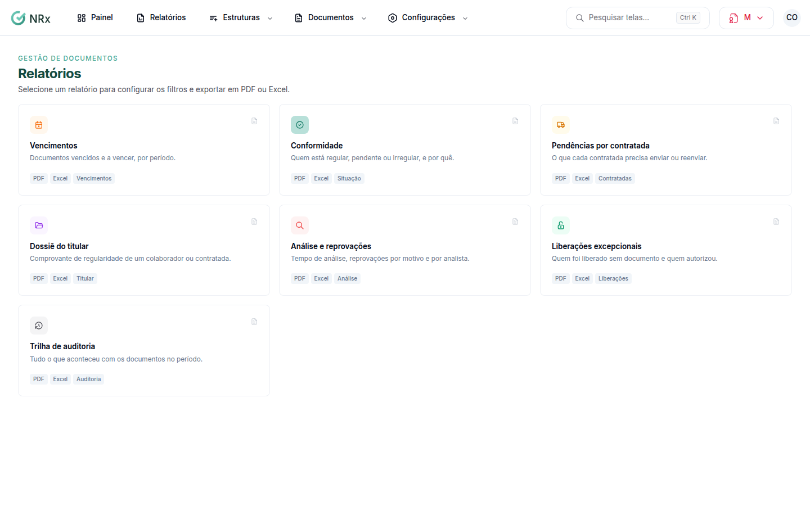

# Gerar um relatório de documentos

**Para que serve:** exportar os relatórios da Gestão de Documentos em PDF ou Excel.


**Quem pode fazer:** Supervisor, Gestor ou Administrador, com a permissão de gerar relatórios da gestão de documentos.


## Antes de começar

* Nada a preparar.

## Passo a passo



### Escolha o relatório

Clique em **Relatórios** e escolha:

* **Vencimentos:** documentos vencidos e a vencer, por período;
* **Conformidade:** quem está regular, pendente ou irregular, e por quê;
* **Pendências por contratada:** o que cada contratada precisa enviar ou reenviar;
* **Dossiê do titular:** comprovante de regularidade de um colaborador ou contratada;
* **Análise e reprovações:** tempo de análise, reprovações por motivo e por analista;
* **Liberações excepcionais:** quem foi liberado sem documento e quem autorizou;
* **Trilha de auditoria:** tudo o que aconteceu com os documentos no período.

<figure><figcaption>
Relatórios
</figcaption></figure>



### Filtre

Escolha o período (**Este mês**, **Mês passado**, **Últimos 3 meses** ou datas), o **Tipo de titular** e os outros filtros. Se quiser, ligue **Incluir desligados e contratadas inativas**.



### Baixe

Clique em **Baixar PDF** ou **Baixar Excel**.



## Deu errado?

| Mensagem na tela | O que fazer |
| --- | --- |
| "A data inicial do período é depois da final." | Corrija as datas. |
| "Escolha só um tipo de titular para o dossiê." | Escolha um tipo de titular. |

## Dúvidas comuns

Qual relatório mostro numa auditoria?

O **Dossiê do titular** comprova a regularidade de um colaborador ou contratada.

Como vejo quem fez o quê?

Use a **Trilha de auditoria**.

