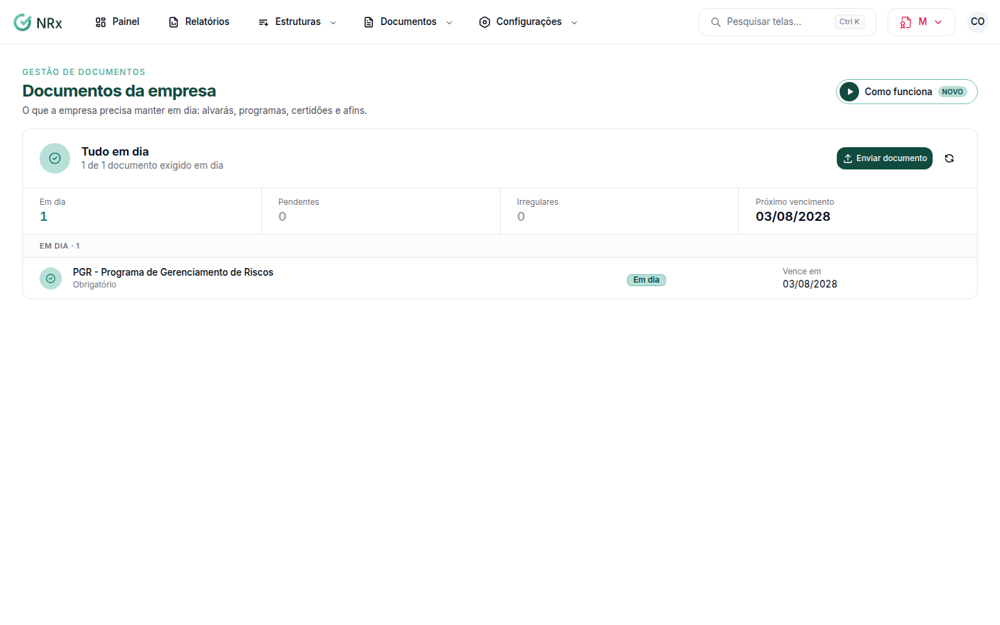

# Manter os documentos da empresa em dia

**Para que serve:** ver o que a empresa precisa manter em dia (alvarás, programas, certidões e afins) e enviar o que falta.


**Quem pode fazer:** todas as roles veem. Para enviar: Supervisor, Gestor ou Administrador, com a permissão de enviar documentos.


## Antes de começar

* O que é exigido vem da [matriz de exigência](../configuracoes/matriz-de-exigencia.md).

## Passo a passo



### Abra a situação

Clique em **Documentos › Documentos da empresa**. A situação aparece como **Tudo em dia**, **Há pendências dentro do prazo** ou **Documentação irregular**.

<figure><figcaption>
Documentos da empresa
</figcaption></figure>



### Envie o que falta

Em cada documento com **Precisa de ação**, clique em **Enviar documento**. Veja [Enviar um documento](../documentos/enviar-documento.md).



## Dúvidas comuns

Apareceu "Nada exigido ainda".

Nenhuma regra da matriz de exigência alcança a empresa. Use **Configurar matriz de exigência**.

A situação não atualizou.

Clique em **Recalcular situação**.

