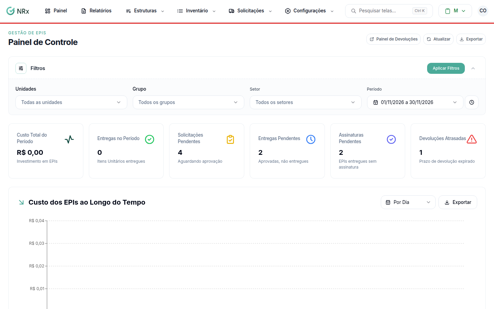
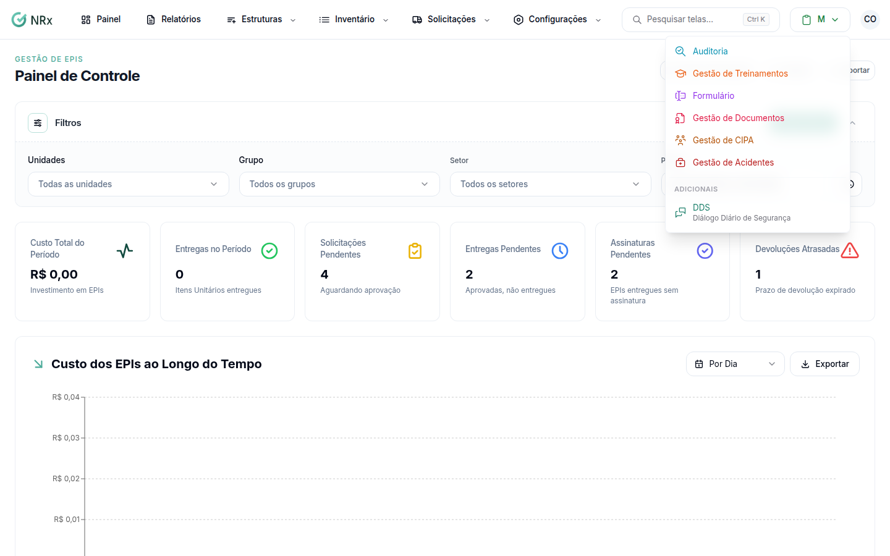
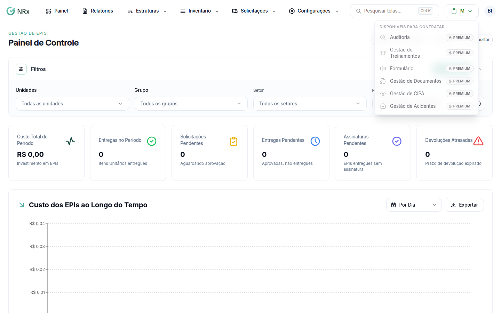
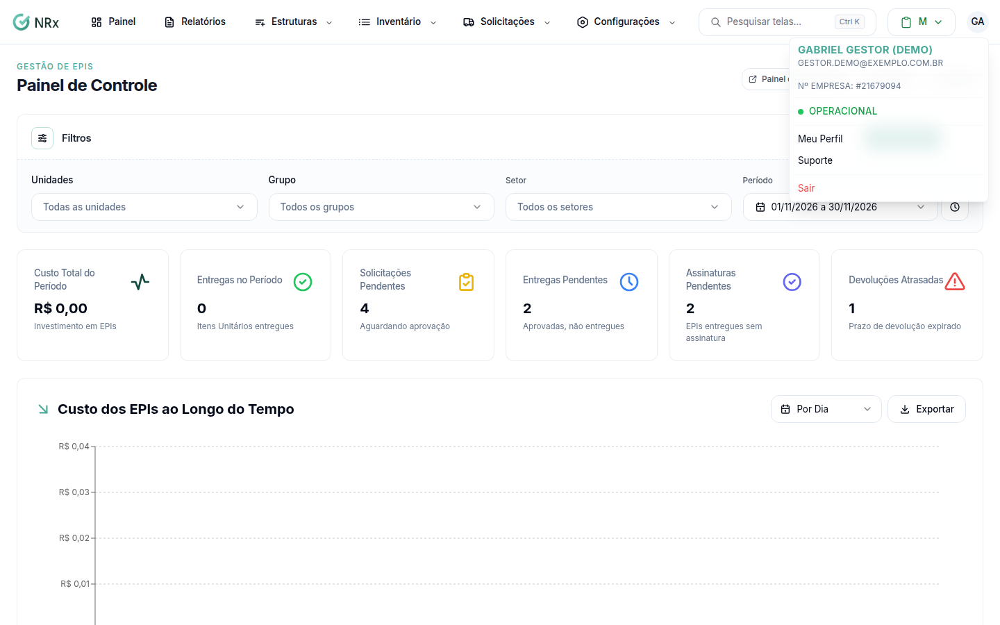

# Conhecer a tela do GNRx

**Para que serve:** saber onde ficam os menus, como trocar de módulo e onde fica o seu perfil.


**Quem pode fazer:** qualquer pessoa com acesso ao GNRx.


## Antes de começar

* [Entre no sistema](entrar-no-sistema.md).

## Passo a passo



### Use a barra de menus

No topo de cada módulo há uma barra com menus que se abrem ao clicar. A ordem costuma ser: **Painel**, **Relatórios** (quando o módulo tem), **Estruturas**, os menus do próprio módulo e **Configurações**. No celular, a barra vira uma lista que abre e fecha.

<figure><figcaption>
Barra de menus
</figcaption></figure>



### Troque de módulo

Abra o seletor de módulos e escolha o módulo. Os módulos são: Gestão de EPIs, Auditoria, Formulário, Gestão de Documentos, Gestão de Treinamentos, Gestão de CIPA, Gestão de Acidentes e DDS.

* Em **Adicionais** fica o DDS (Diálogo Diário de Segurança).
* Em **Disponíveis para contratar** ficam os módulos que a sua empresa ainda não tem. Ao clicar num deles, aparece "Sua empresa ainda não tem este módulo.", com os botões **Agora não** e **Conhecer o módulo**.

<figure><figcaption>
Módulos da empresa e Adicionais
</figcaption></figure>

<figure><figcaption>
Disponíveis para contratar
</figcaption></figure>



### Abra o menu do usuário

No canto da tela, abra o menu do usuário. Nele você encontra:

* **Meu Perfil** (no acesso Usuário) ou **Minha Empresa** (no acesso Empresa);
* **Meus Parceiros** (só no acesso Empresa);
* **Suporte**;
* **Sair**.

<figure><figcaption>
Menu do usuário
</figcaption></figure>



## Dúvidas comuns

Falta um item no meu menu. Por quê?

Você só vê os itens que tem permissão para usar. Se falta um item no seu menu, peça ao administrador.

Um módulo não abre. O que faço?

Veja [Entender por que um módulo não abre](modulos-e-periodo-de-teste.md).

