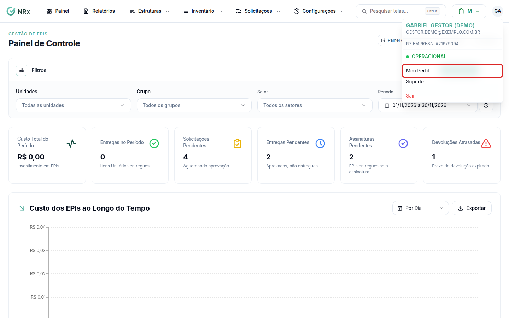
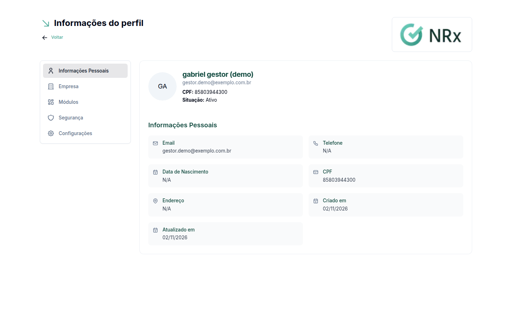

# Ver o seu perfil

**Para que serve:** conferir os seus dados, a sua empresa e os módulos que você pode usar.


**Quem pode fazer:** qualquer pessoa que entra pela aba **Usuário**. No acesso Empresa, veja [Minha Empresa](../minha-empresa/README.md).


## Antes de começar

* [Entre no sistema](entrar-no-sistema.md) pela aba **Usuário**.

## Passo a passo



### Abra o seu perfil

No canto da tela, abra o menu do usuário e clique em **Meu Perfil**.

<figure><figcaption>
Menu do usuário
</figcaption></figure>



### Confira as seções

Em **Informações do perfil** estão as seções:

* **Informações Pessoais:** os seus dados.
* **Empresa:** em **Vinculado à Empresa**, o e-mail, o telefone e o endereço da empresa.
* **Módulos:** em **Acesso aos Módulos**, os módulos liberados para você.
* **Segurança:** a [verificação em duas etapas](verificacao-em-duas-etapas.md).
* **Configurações**.

<figure><figcaption>
Informações do perfil
</figcaption></figure>



## Dúvidas comuns

Como mudo o meu nome, e-mail ou telefone?

Só o administrador da sua empresa altera os seus dados pessoais, na tela de Usuários.

Falta um módulo na seção Módulos.

Veja [Entender por que um módulo não abre](modulos-e-periodo-de-teste.md).

