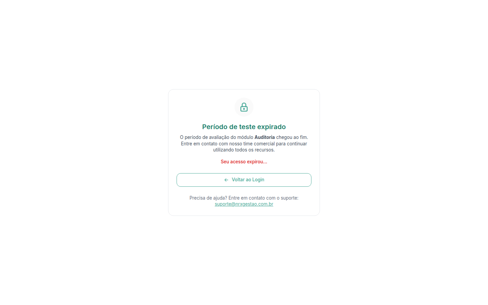

# Entender por que um módulo não abre

**Para que serve:** descobrir por que você não consegue usar um módulo e a quem pedir.


**Quem pode fazer:** qualquer pessoa com acesso ao GNRx. Quem liga os módulos da empresa é a GNRx.


## Antes de começar

Para usar um módulo, duas coisas precisam ser verdade:

* a sua empresa contratou o módulo (ou está no período de teste);
* o módulo está ligado no seu usuário.

## Passo a passo



### Veja se a empresa tem o módulo

Abra o seletor de módulos. Se o módulo está em **Disponíveis para contratar**, a sua empresa ainda não tem. Peça ao seu contato comercial da GNRx.



### Veja se o módulo está ligado para você

Abra o [seu perfil](meu-perfil.md) e veja a seção **Módulos**. Se o módulo não está liberado, peça ao administrador da sua empresa.



## Deu errado?

| Mensagem na tela | O que fazer |
| --- | --- |
| Tela de acesso negado | A empresa não contratou o módulo. Fale com o seu contato comercial da GNRx. |
| "Período de teste expirado" | O teste acabou. Fale com o time comercial da GNRx para continuar. |
| "Sua empresa ainda não tem este módulo." | Clique em **Conhecer o módulo** para saber mais ou em **Agora não** para voltar. |
| "O usuário não possui permissão para acessar nenhum módulo." | Peça ao administrador para liberar um módulo no seu cadastro. |

<figure><figcaption>
Período de teste expirado
</figcaption></figure>

Na tela **Período de teste expirado**, a lista **Status dos módulos:** mostra o selo **Expirado** nos módulos vencidos. Clique em **Voltar ao Login** para sair.

## Dúvidas comuns

O administrador da minha empresa pode contratar um módulo pelo sistema?

Não. Quem liga os módulos da empresa é a GNRx. Peça ao seu contato comercial.

A empresa tem o módulo, mas eu não. Por quê?

O módulo não está ligado no seu usuário. Peça ao administrador da sua empresa.

