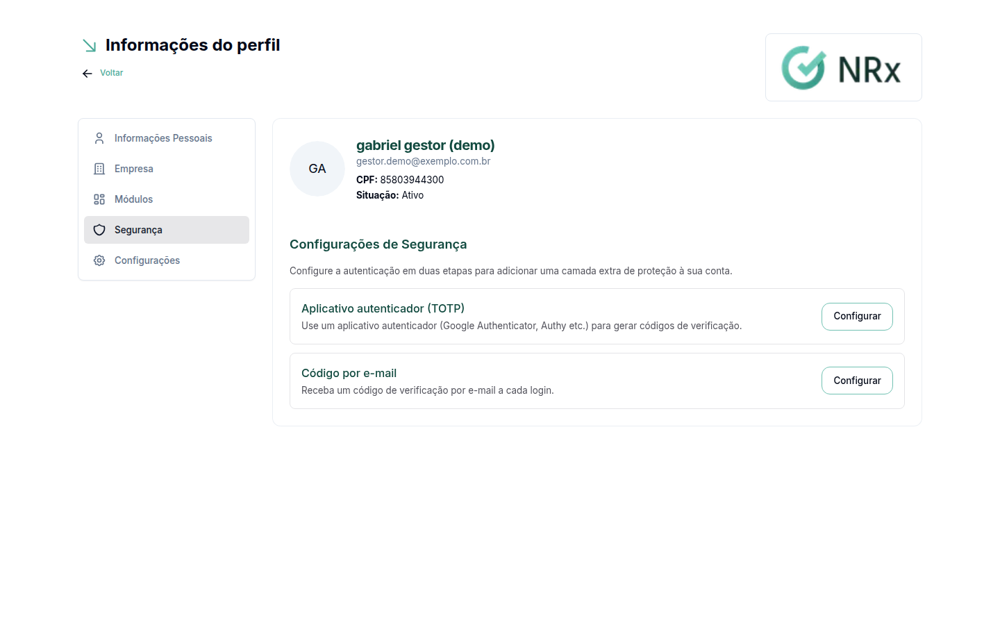
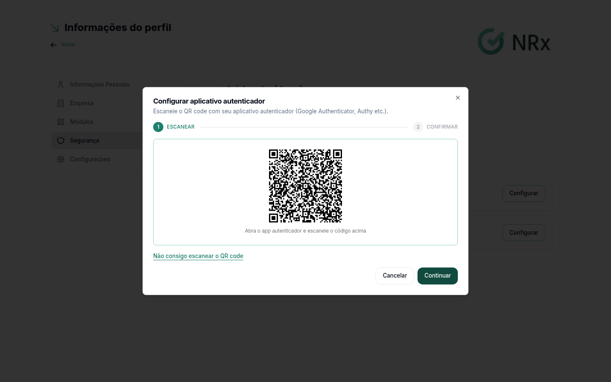
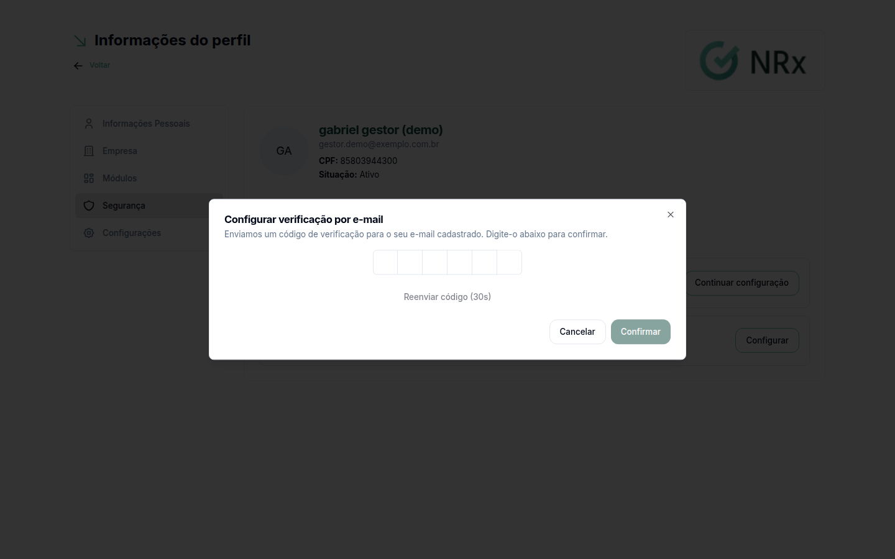

# Configurar a verificação em duas etapas

**Para que serve:** cadastrar um segundo jeito de confirmar que é você no login: um aplicativo autenticador, o e-mail ou os dois.


**Quem pode fazer:** qualquer usuário, em **Meu Perfil**, e o acesso Empresa, em **Minha Empresa**.


## Antes de começar

* Para usar um aplicativo, instale um aplicativo autenticador no celular (Google Authenticator, Authy etc.).

## Passo a passo



### Abra a segurança

* No acesso Usuário: menu do usuário, **Meu Perfil › Segurança**. Abre **Configurações de Segurança**.
* No acesso Empresa: menu do usuário, **Minha Empresa › Segurança**. Os seus fatores ficam em **Seus fatores de verificação**.

<figure><figcaption>
Configurações de Segurança
</figcaption></figure>



### Configure o aplicativo autenticador

Em **Aplicativo autenticador (TOTP)**, clique em **Configurar aplicativo autenticador**. Abra o aplicativo no celular e escaneie o QR code. Digite os 6 dígitos que aparecem no aplicativo e clique em **Confirmar código**.

Não consegue escanear? Clique em **Não consigo escanear o QR code** e digite o código no aplicativo.

<figure><figcaption>
QR code do aplicativo autenticador
</figcaption></figure>



### Ou configure o código por e-mail

Em **Código por e-mail**, comece a configuração. Aparece "Enviamos um código de verificação para o seu e-mail". Digite o código para confirmar. A partir daí, você recebe um código a cada login.

<figure><figcaption>
Código por e-mail
</figcaption></figure>



## Dúvidas comuns

Posso ter os dois?

Pode. No login, você escolhe qual usar.

Como tiro um dos dois?

Clique em **Remover** ao lado dele e confirme.

Sou obrigado a configurar?

Depende da sua empresa. Ela pode [exigir a verificação](../minha-empresa/exigir-verificacao.md) para o acesso Empresa e para algumas roles.

