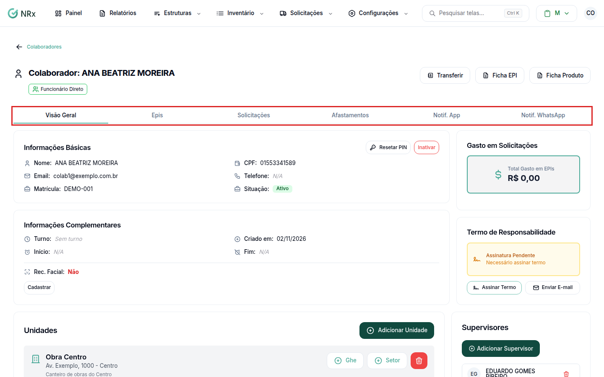

# Ver os EPIs do colaborador

**Para que serve:** ver quais EPIs o colaborador está usando, quais faltam, quanto já foi gasto com ele e todas as solicitações dele.


**Quem pode fazer:** todas as roles (Operador, Supervisor, Gestor e Administrador), com a permissão de ver colaboradores.


## Antes de começar

* Nada a preparar.

## Passo a passo



### Abra o colaborador

Clique em **Estruturas › Colaboradores** e abra o colaborador. Na **Visão Geral**, veja o **Total Gasto em EPIs**, o **Gasto em Solicitações** e o **Termo de Responsabilidade**.

<figure><figcaption>
Ficha do colaborador
</figcaption></figure>



### Veja os EPIs

Clique na aba **Epis**. Em **EPIs do Colaborador**, cada EPI aparece como **Em uso**, **Sem proteção**, **Nunca solicitado** ou **Disponível**. Use **Buscar EPIs...** e **Filtrar por status** (ex.: **Sem Proteção (Obrigatórios)**). Clique em **Ver Itens Ativos** para ver as unidades em uso e o **Histórico**.



### Veja as solicitações

Clique na aba **Solicitações**. Em **Solicitações de EPI do Colaborador**, busque por número, item ou CA. Clique em **Ver Detalhes** para abrir.




No topo da ficha aparecem os avisos **Urgente: EPIs não devolvidos** e **Atenção: EPIs próximos da data de devolução**. Clique em **Ir para Devolução** para registrar.


## Dúvidas comuns

O termo aparece como Assinatura Pendente.

Clique em **Assinar Termo** ou em **Enviar E-mail**. Veja [Assinar o termo de responsabilidade](../configuracoes-iniciais/colaboradores/termo-de-responsabilidade.md).

Preciso da ficha de EPI em papel.

Veja [Gerar a ficha de EPI](../configuracoes-iniciais/colaboradores/ficha-de-epi.md).

