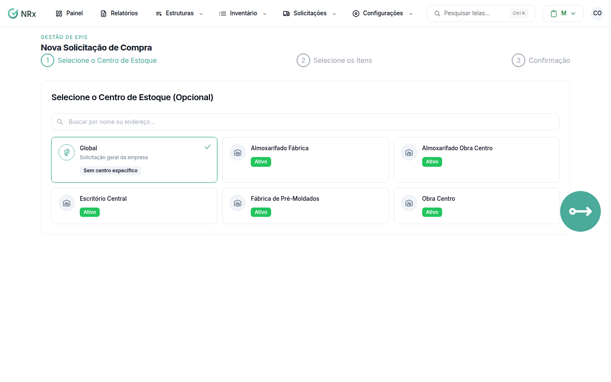

# Criar uma solicitação de compra

**Para que serve:** pedir a compra de EPIs e produtos, para repor o estoque.


**Quem pode fazer:** todas as roles, com a permissão de criar solicitações de compra.


## Antes de começar

* Os itens precisam estar cadastrados no inventário.

## Passo a passo



### Escolha o centro de estoque

Clique em **Inventário › Solicitações de Compra** e crie uma nova. Em **Selecione o Centro de Estoque (Opcional)**, escolha o centro ou **Global**.

<figure><figcaption>
Nova Solicitação - Compra
</figcaption></figure>



### Selecione os itens

Em **Selecione os Itens**, busque por nome, CA ou fabricante e informe a quantidade (e as variações, se houver).



### Revise e envie

Confira o **Resumo da Solicitação**. Se quiser, escreva as **Observações Adicionais** (ex.: urgente, prazo, preferência de fornecedor). Envie.



## Deu errado?

| Mensagem na tela | O que fazer |
| --- | --- |
| "Selecione pelo menos um item" | Escolha os itens. |
| "Nenhum item disponível" | Cadastre itens no inventário para solicitar compras. |

## Dúvidas comuns

E depois de criar?

A solicitação é orçada e aprovada. Veja [Orçar e aprovar uma compra](orcar-e-aprovar-compra.md).

Posso cancelar?

Pode, com a permissão de cancelar solicitações de compra. Aparece "Solicitação cancelada com sucesso!".

