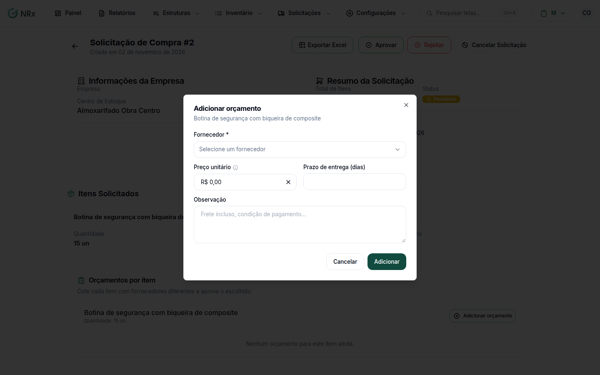

# Orçar e aprovar uma compra

**Para que serve:** cotar cada item com os fornecedores, escolher o orçamento e aprovar ou rejeitar a compra.


**Quem pode fazer:** Supervisor, Gestor ou Administrador, com a permissão de adicionar e aprovar orçamentos e a de aprovar solicitações de compra.


## Antes de começar

* Para usar o preço do catálogo, [vincule os itens aos fornecedores](../gestao-estoque/fornecedores/vincular-itens.md).

## Passo a passo



### Adicione os orçamentos

Abra a solicitação. Em cada item, use **Adicionar orçamento**. Escolha uma **Sugestão do catálogo** (**Melhor preço** ou **Melhor qualidade**) ou o fornecedor à mão, e informe o **Preço unitário**, o **Prazo de entrega (dias)** e a **Observação** (ex.: frete incluso). Clique em **Adicionar**. Aparece "Orçamento adicionado.".

<figure><figcaption>
Adicionar orçamento
</figcaption></figure>



### Aprove o orçamento

Escolha o orçamento de cada item e aprove. Aparece "Orçamento aprovado.".



### Aprove a solicitação

Aprove ou rejeite a solicitação. Aparece "Solicitação aprovada com sucesso!" ou "Solicitação rejeitada com sucesso!". Se a empresa usa [fluxo de aprovação](../fluxos-aprovacao/decidir-aprovacao.md), a decisão é pelo fluxo.



## Deu errado?


**"Este fornecedor já tem um orçamento para este item."**: edite o orçamento que já existe.


## Dúvidas comuns

De onde vem o preço sugerido?

Do vínculo cadastrado do fornecedor com o item. Se você digitar o preço, ele fica marcado como manual.

Posso anexar a cotação?

Pode. Na solicitação, anexe o arquivo. Aparece "O arquivo foi anexado à solicitação.".

