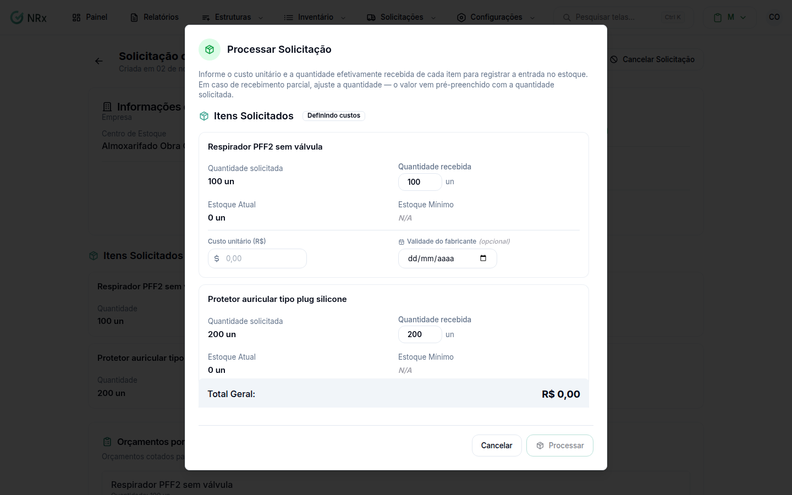

# Processar uma compra

**Para que serve:** dar entrada no estoque dos itens comprados, com os custos informados.


**Quem pode fazer:** Gestor ou Administrador, com a permissão de marcar a solicitação como processada.


## Antes de começar

* A solicitação precisa estar aprovada, com os orçamentos.

## Passo a passo



### Clique em Processar

Abra a solicitação e clique em **Processar**. Abre **Processar Solicitação**, com o **Total Geral**.

<figure><figcaption>
Processar Solicitação
</figcaption></figure>



### Confirme

Confirme. Lotes são criados com os custos informados. Aparece "Solicitação processada!": "Os itens foram adicionados ao estoque com sucesso.".



## Dúvidas comuns

Preciso dar entrada à mão depois?

Não. Ao processar, os itens entram no estoque.

Onde vejo todos os orçamentos?

Na tela de **Orçamentos**: todos os orçamentos de compra da empresa, por fornecedor, item e solicitação.

