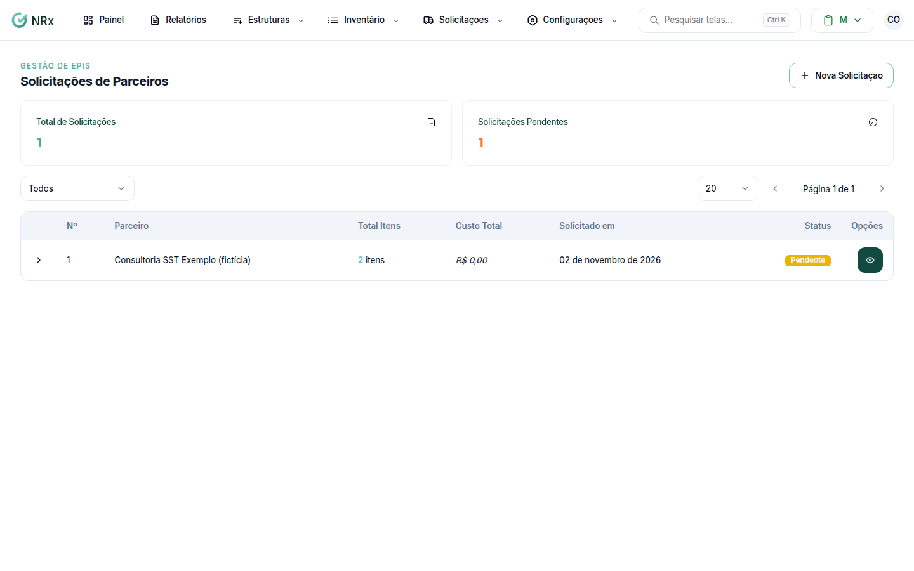

# Pedir EPIs ao parceiro

**Para que serve:** pedir EPIs direto ao seu fornecedor parceiro, que atende a empresa pelo GNRx.


**Quem pode fazer:** quem abre **Inventário › Solicitações de Parceiros**.


## Antes de começar

* O parceiro precisa ter acesso aprovado. Veja **Meus Parceiros**, no menu do usuário.

## Passo a passo



### Crie a solicitação

Clique em **Inventário › Solicitações de Parceiros** e em **Nova Solicitação**. Escolha os itens, as variações e as quantidades. Envie.

<figure><figcaption>
Solicitações de Parceiros
</figcaption></figure>



### Acompanhe

A lista mostra o **Parceiro**, o **Total Itens**, o **Custo Total** e o **Status**: **Pendente**, **Em análise**, **Aprovada**, **Aprovada c/ Ressalva**, **Rejeitada** ou **Cancelada**.



## Dúvidas comuns

Como filtro?

Use **Filtrar por status**.

Como o parceiro entra?

Pelo acesso aprovado em **Meus Parceiros**.

