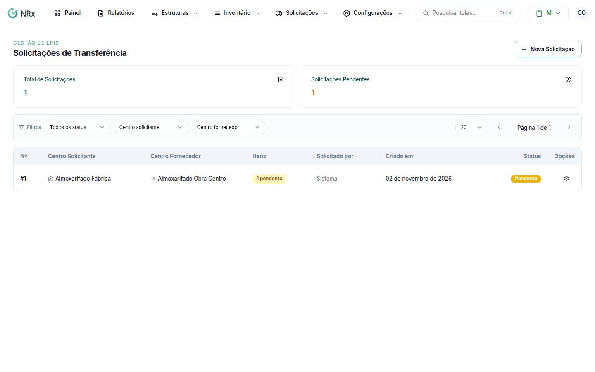

# Transferir entre centros de estoque

**Para que serve:** pedir EPIs de um centro de estoque para outro (transferência entre unidades), e aprovar e processar a transferência.


**Quem pode fazer:** Gestor ou Administrador, com a permissão de ver todas as solicitações de transferência (é ela que abre a tela), e as de aprovar, rejeitar e processar item de transferência.


## Antes de começar

* Os dois centros de estoque precisam existir.

## Passo a passo



### Crie a solicitação

Clique em **Inventário › Solicitações de Transferência** e em **Nova Solicitação**. Escolha o **Centro Solicitante** (quem recebe), o **Centro Fornecedor** (de onde sai) e os itens.

<figure><figcaption>
Solicitações de Transferência
</figcaption></figure>



### Aprove cada item

Abra a solicitação. Em cada item, clique em **Aprovar item** e em **Confirmar aprovação**. Ou clique em **Rejeitar item**, escreva o **Motivo da rejeição** (ex.: A obra já possui estoque suficiente.) e clique em **Confirmar rejeição**. Aparece "Item aprovado com sucesso!" ou "Item rejeitado.".



### Processe

Clique em **Processar item**, escolha o **Centro de estoque de origem** e clique em **Confirmar processamento**. Aparece "Item processado! Estoque transferido com sucesso.".



## Dúvidas comuns

O centro fornecedor não tem o item.

Use **Solicitar compra** no item. Ele fica **Aguardando Compra**. Para ligar uma compra que já existe, use **Vincular compra** e informe o **ID da solicitação de compra**.

Sou Supervisor e não vejo a tela.

A tela de transferências exige a permissão de ver todas as solicitações de transferência (Gestor e Administrador). Peça a um gestor.

Como cancelo um item?

Use **Cancelar item**. O item é cancelado e não pode ser reativado.

