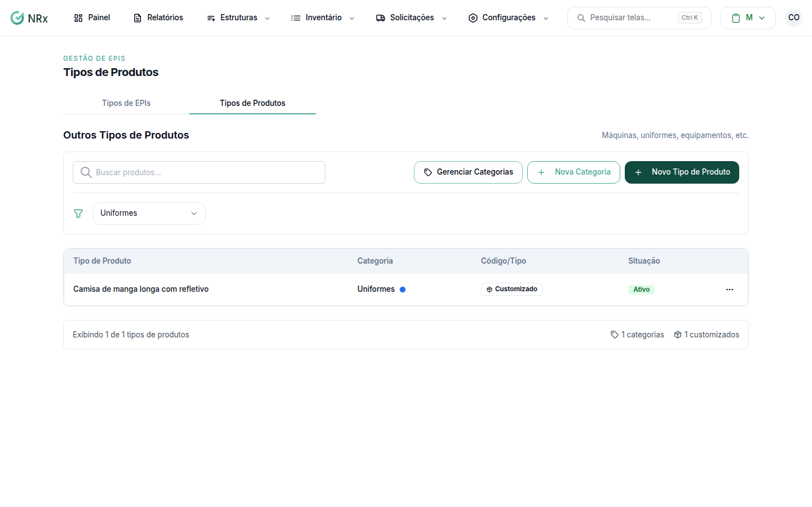

# Criar um tipo de produto

**Para que serve:** cadastrar tipos de produto que não são EPI (máquinas, uniformes, equipamentos), organizados por categoria.


**Quem pode fazer:** Gestor ou Administrador, com a permissão de cadastrar EPIs NR-6 customizados.


## Antes de começar

* Crie a categoria, se ela ainda não existe.

## Passo a passo



### Crie a categoria (se precisar)

Clique em **Configurações › Tipos de Produtos** e abra **Outros Tipos de Produtos**. Clique em **Nova Categoria**. Informe o nome (ex.: Máquinas, Uniformes, Ferramentas), a **Cor da Categoria** e o **Ícone da Categoria**. Clique em **Criar Categoria**. Aparece "Categoria criada com sucesso.".

<figure><figcaption>
Outros Tipos de Produtos
</figcaption></figure>



### Crie o tipo de produto

Escolha a categoria e clique em **Novo Tipo de Produto**. Digite o nome e a descrição. Clique em **Criar Tipo de Produto**. Aparece "Produto criado com sucesso.".



## Deu errado?

| Mensagem na tela | O que fazer |
| --- | --- |
| "Nome é obrigatório" | Preencha o nome. |
| "Categoria é obrigatória" | Escolha a categoria. |
| "Cor deve estar no formato #RRGGBB" | Escolha a cor pelo seletor. |

## Dúvidas comuns

Preciso trocar a categoria de um produto.

Use **Editar Categoria/Tipo**, escolha a nova categoria e salve. Aparece "Produto atualizado com sucesso.".

Como excluo uma categoria com produtos?

Em **Gerenciar Categorias**, use **Excluir categoria**. Se ela tiver produtos, **Mover produtos antes de excluir**: escolha a **Categoria de destino** e clique em **Mover e excluir categoria**.

