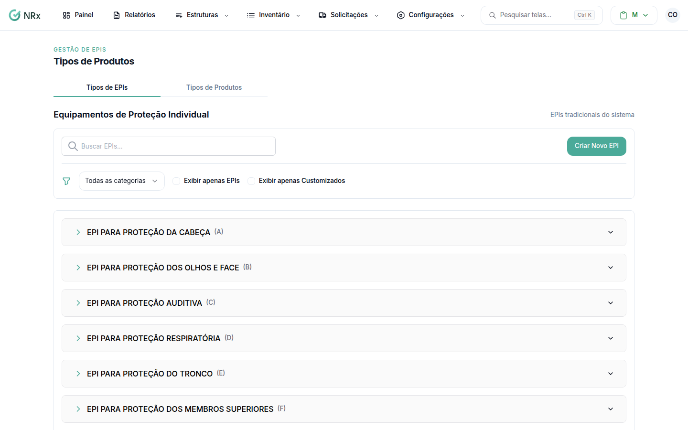

# Consultar e criar tipos de EPI

**Para que serve:** ver os tipos de EPI do sistema e cadastrar os da empresa (customizados).


**Quem pode fazer:** Gestor ou Administrador, com a permissão de cadastrar EPIs NR-6 customizados.


## Antes de começar

* Os EPIs tradicionais já vêm no sistema.

## Passo a passo



### Abra os tipos de EPI

Clique em **Configurações › Tipos de Produtos** e abra **Tipos de EPIs**. Use **Buscar EPIs...**, **Todas as categorias**, **Exibir apenas EPIs** ou **Exibir apenas Customizados**.

<figure><figcaption>
Tipos de EPIs
</figcaption></figure>



### Crie um EPI customizado

Clique em **Criar Novo EPI**. A janela abre com "Preencha os campos abaixo para adicionar um novo EPI.". Escolha a **Categoria EPI** e digite a descrição. Salve. Aparece "EPI criado com sucesso.".



## Deu errado?

| Mensagem na tela | O que fazer |
| --- | --- |
| "Descrição é obrigatória" | Digite a descrição. |
| "Erro ao carregar os EPIs!" | Atualize a página. |

## Dúvidas comuns

Como tiro um EPI customizado?

Use **Inativar EPI** e confirme. Aparece "EPI inativado com sucesso.". Precisa da permissão de inativar EPIs NR-6 customizados.

Onde cadastro o item que vai para o estoque?

No catálogo de itens do inventário. O tipo de EPI é só a classificação.

