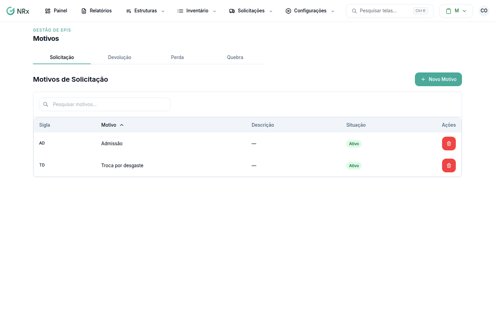

# Cadastrar um motivo de devolução

**Para que serve:** cadastrar os motivos que aparecem para quem vai devolver um EPI.


**Quem pode fazer:** Gestor ou Administrador, com a permissão de criar motivos de EPI.


## Antes de começar

* Veja se o motivo já existe. Use **Pesquisar motivos...**.

## Passo a passo



### Abra a aba Devolução

Clique em **Configurações › Motivos de Solicitação de EPI** e abra a aba **Devolução**.

<figure><figcaption>
Motivos
</figcaption></figure>



### Crie o motivo

Clique em **Novo Motivo**. Preencha o **Motivo** (de 3 a 100 caracteres), a **Sigla** (de 1 a 4 caracteres) e, se quiser, a **Descrição (opcional)**. Salve.



## Deu errado?

| Mensagem na tela | O que fazer |
| --- | --- |
| "O motivo deve ter no mínimo 3 caracteres" | Escreva o motivo completo. |
| "A sigla deve ter no máximo 4 caracteres" | Encurte a sigla. |

## Dúvidas comuns

Como tiro um motivo da lista?

Use **Inativar Motivo**. Aparece "Motivo inativado com sucesso!". Para trazer de volta, use **Reativar Motivo**.

E os outros tipos de motivo?

Cada aba da tela tem os seus: **Solicitação**, **Devolução**, **Perda** e **Quebra**.

