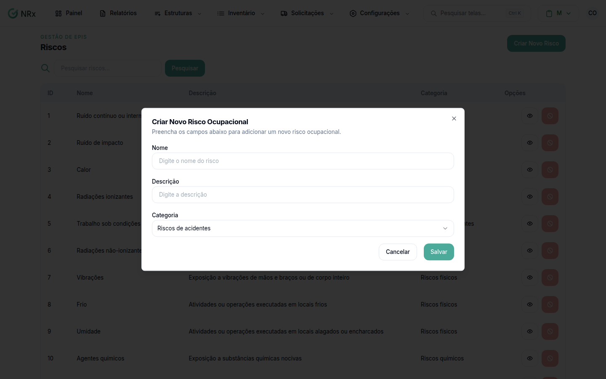

# Adicionar um risco

**Para que serve:** cadastrar um risco ocupacional ou ambiental, para ligar aos GHEs e aos EPIs.


**Quem pode fazer:** Gestor ou Administrador, com a permissão de cadastrar riscos ocupacionais.


## Antes de começar

* Veja se o risco já existe. Use a [busca](listar-riscos.md).

## Passo a passo



### Clique em Criar Novo Risco

Clique em **Configurações › Riscos** e depois em **Criar Novo Risco**. Abre **Criar Novo Risco Ocupacional**.

<figure><figcaption>
Criar Novo Risco Ocupacional
</figcaption></figure>



### Preencha e salve

Preencha o **Nome**, a **Descrição** e a **Categoria**. Salve. Aparece "Risco criado com sucesso.".



## Deu errado?

| Mensagem na tela | O que fazer |
| --- | --- |
| "Nome é obrigatório" | Preencha o nome. |
| "Descrição é obrigatória" | Preencha a descrição. |
| "Categoria é obrigatória" | Escolha a categoria. |

## Dúvidas comuns

E depois de criar?

Vincule os EPIs e os GHEs. Veja [Vincular EPIs e GHEs a um risco](vincular-risco.md).

Também dá para vincular pelo GHE?

Dá. No GHE, aba **Riscos / EPIs**, use **Gerenciar riscos**. Veja [Vincular riscos a um GHE](../../configuracoes-iniciais/ghes/vincular-riscos.md).

