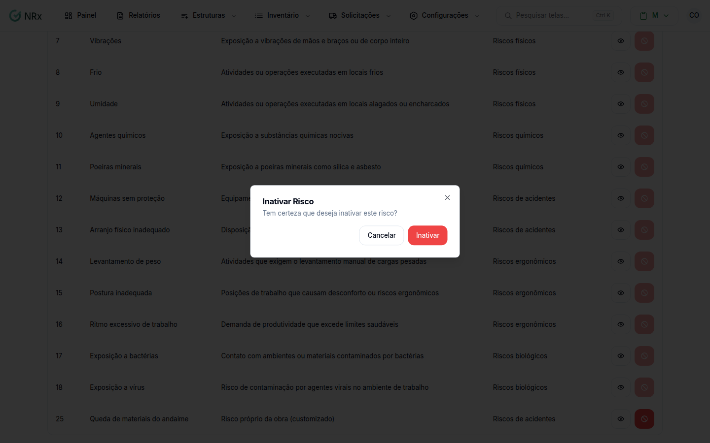

# Inativar um risco

**Para que serve:** tirar da lista um risco que a empresa não usa mais.


**Quem pode fazer:** Gestor ou Administrador, com a permissão de inativar riscos ocupacionais.


## Antes de começar

* Confira se o risco é mesmo o certo. Use a [busca](listar-riscos.md).

## Passo a passo


Atenção: depois de inativar, não dá para reativar pelo sistema. Se inativou por engano, abra um [chamado no Suporte](../../suporte/abrir-chamado.md).




### Inative

Clique em **Configurações › Riscos**. Em **Opções**, use **Inativar Risco**. Confirme: "Tem certeza que deseja inativar este risco?".

<figure><figcaption>
Inativar Risco
</figcaption></figure>



### Pronto

Aparece "Risco inativado com sucesso.".



## Dúvidas comuns

Apareceu "Ocorreu um erro ao carregar os riscos."

Atualize a página e tente de novo.

Posso reativar?

A tela de riscos não mostra a opção de reativar.

