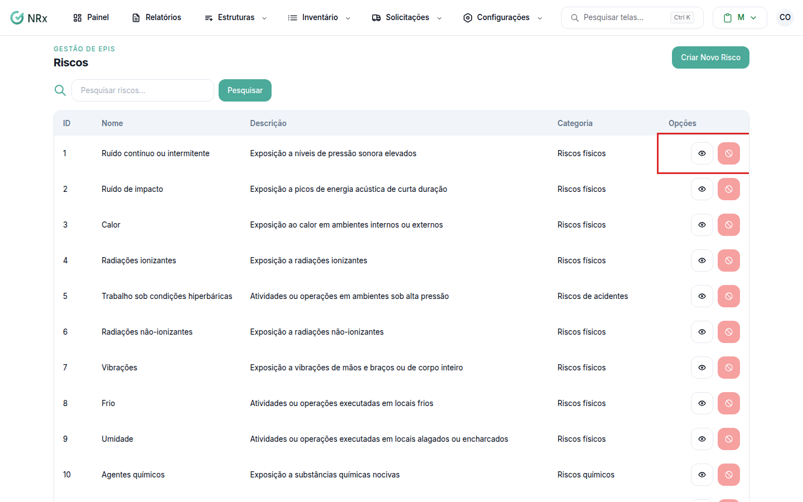

# Encontrar um risco

**Para que serve:** achar um risco e abrir os EPIs e GHEs dele.


**Quem pode fazer:** Gestor ou Administrador, com a permissão de ver todos os riscos ocupacionais.


## Antes de começar

* Nada a preparar.

## Passo a passo



### Abra a lista

Clique em **Configurações › Riscos**. Digite em **Pesquisar riscos...** (a pesquisa é no nome) e clique em **Pesquisar**.

<figure><figcaption>
Riscos
</figcaption></figure>



### Abra o risco

Em **Opções**, clique em **Visualizar risco**.



## Dúvidas comuns

Apareceu "Nenhum risco encontrado."

Confira o termo e clique em **Limpar**.

O que aparece dentro do risco?

Os **EPIs do Risco** e os **GHEs em que este risco se aplica**. Veja [Vincular EPIs e GHEs a um risco](vincular-risco.md).

