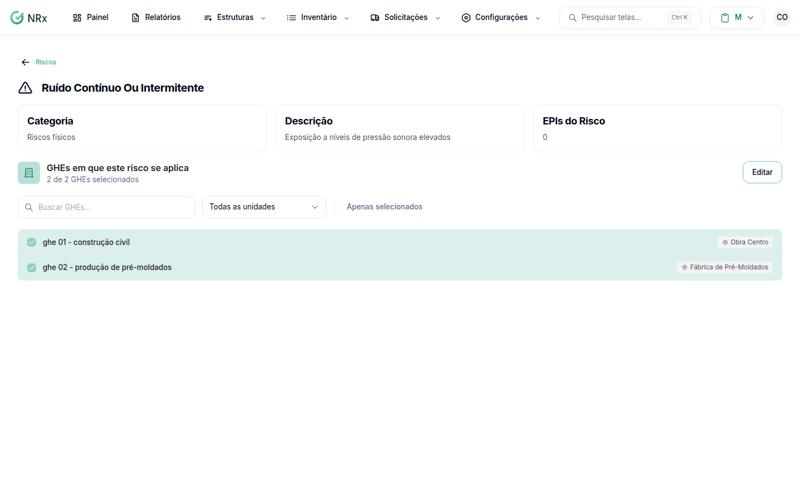

# Vincular EPIs e GHEs a um risco

**Para que serve:** dizer quais EPIs protegem do risco e em quais GHEs ele se aplica.


**Quem pode fazer:** Gestor ou Administrador, com a permissão de associar EPIs aos GHEs.


## Antes de começar

* [Adicione o risco](adicionar-risco.md).

## Passo a passo



### Abra o risco

Clique em **Configurações › Riscos**. Em **Opções**, clique em **Visualizar risco**.

<figure><figcaption>
Detalhe do risco
</figcaption></figure>



### Marque os EPIs

Em **EPIs do Risco**, clique em **Editar**, use **Buscar EPIs...** e marque os EPIs. Clique em **Salvar**. Aparece "EPIs atualizados com sucesso".



### Marque os GHEs

Em **GHEs em que este risco se aplica**, clique em **Editar**, use **Buscar GHEs...** e marque os GHEs. Clique em **Salvar**. Aparece "GHEs do risco atualizados com sucesso".



## Dúvidas comuns

Como vejo só o que está marcado?

Use **Mostrar Apenas Selecionados** (EPIs) ou **Apenas selecionados** (GHEs).

Posso filtrar os GHEs por unidade?

Pode. Escolha a unidade ou **Todas as unidades**.

